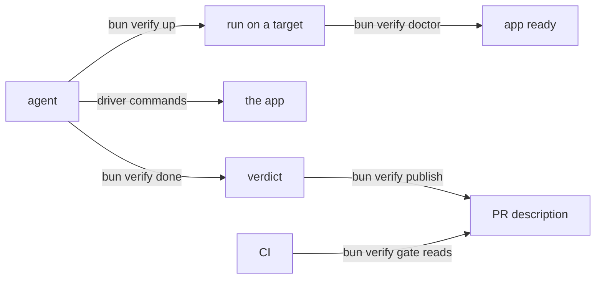

# How a change is verified

This doc uses the words the [terms](../reference/terms.md) page defines: registry, target, driver,
command, feature, journey, run, doctor, verdict, fingerprint, evidence, report and gate.

Each repo builds its own verify CLI, run as `bun verify`, from the `@wringer/*` packages and a
registry of its own. A coding agent uses that CLI to drive the repo's real app, records a verdict
for each feature it changed, and publishes a report into the PR. In CI, `bun verify gate` reads that
report, and fails the PR when a changed feature has no verdict on its current code.

## The path of a change

1. The agent starts a run on a target. On a launch target, `up` launches the app. On an attach
   target, `attach` reaches an app that already runs elsewhere.
2. The agent runs `doctor`, whose checks show that the app and each driver are ready.
3. The agent drives each changed feature's journey with the driver commands, such as a browser click
   or an http request. Each command writes its evidence.
4. The agent runs `done`, which records the feature's verdict together with the feature's
   fingerprint, a hash of the feature's part of the branch diff.
   [Verdicts and the gate](./verdicts.md) covers how a verdict is tied to the feature's code.
5. The agent runs `publish`, which writes the report into the PR description and uploads the
   evidence to the repo's file host. [PR report](./pr-report.md) covers it.
6. CI runs `gate`, which computes every feature's fingerprint itself and compares each one with the
   fingerprint in the report.

## Processes

Each CLI command runs as its own short process. A run also has one supervisor process: `up` or
`attach` starts it, and `down` or `detach` stops it. A launch target is one that `up` starts, such
as the app on the agent's machine, and on it the supervisor owns the app and every driver's
background service, such as the browser. An attach target is one that `attach` reaches without
starting it, such as a deployed preview, and on it the supervisor owns only the driver services. The
supervisor writes the run's events to the run log.

## State

wringer keeps everything a run writes in the repo's `.wringer/` folder:

- the run log;
- the run's secrets file, which holds the secrets that the run's commands learned, so that each
  later command can scrub them;
- the evidence of each feature;
- a record of each evidence link `publish` uploaded, so a later `publish` reuses it.

wringer leaves `.wringer/` out of the changed paths and the fingerprints, so the evidence that a run
writes never changes the fingerprints the run is checked against. Only the report in the PR
description and the evidence on the file host leave the machine.

## Secrets

wringer scrubs each secret it knows, from the registry, the environment and the secrets file, out of
all the text it writes. It also checks each file before the file leaves the machine.
[Redaction](./redaction.md) covers both.

## wringer on itself

wringer verifies its own changes with its own CLI and a registry of its own, against a small shop
app in `packages/shop-example/`. [Self-verify](./self-verify.md) covers that registry, the verify
skill that tells an agent how to verify each feature, and the CI jobs.
