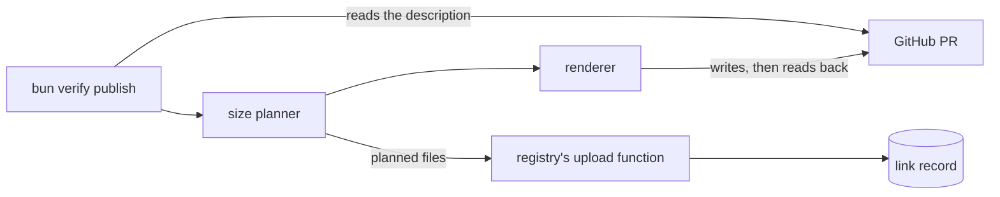

# PR report

This doc uses the words the [terms](../reference/terms.md) page defines: registry, target, command,
feature, journey, run, verdict, evidence, report and gate.

`bun verify publish` writes a PR's report into the PR description and uploads the report's evidence.
The report holds these parts:

- one line for each changed feature. A verified feature's line opens to its journey table, with one
  row per command and links to its evidence. A stale or unverified feature's line gives the fix.
- one line that names the unchanged features, the first 2 and a count when there are more than 3;
- the data comment, which `bun verify gate` reads in CI. [Verdicts and the gate](./verdicts.md)
  covers it.

`publish` is the only command that writes to the PR or uploads a file. An agent runs
`bun verify report` to see where it stands, and `report` never changes anything.

Every file passes the upload guard before it leaves the machine, as [Redaction](./redaction.md)
describes.

## The report in the description

The report sits between two HTML comments, `<!-- wringer:report -->` and `<!-- /wringer:report -->`.
`publish` never changes a byte outside them, so the author's own text survives every publish.
`publish` puts the report where it already sits. With no report yet, it puts it at the end of the
`## Verification` section, or under a new `## Verification` heading at the end of the description.
`publish` skips a marker or a heading inside a fenced code block, because that is the author's text.
It fails, and writes nothing, when the description holds two reports or a marker without its
partner, because then it can't tell which report is its own. The report takes the description's line
ending. When the description already holds the same report, `publish` leaves it untouched.

GitHub's API updates a PR description with no version check, so `publish` guards against another
writer with reads:

1. It reads the description and plans the report.
2. It uploads the files that the plan includes.
3. It reads the description again, and plans the report again against that read.
4. It writes the description.
5. It reads the description once more. When the report there differs from the one it wrote, another
   writer replaced it, and `publish` fails and tells the agent to run it again.

An edit that lands between steps 3 and 4 is lost. That window is one request long.

`publish` calls GitHub's REST API with `GITHUB_TOKEN`, or the token of `gh auth login` when that
variable is unset. It picks each error and its hint from the HTTP status code, such as a hint to set
a valid token on a 401, and never puts the token or a response body into an error.

## Size

The planner fits the report into its budget: `maxDescriptionChars`, the length that GitHub allows,
less the author's text and a margin of `marginChars`. `resolveSpanBudget` in `@wringer/core` holds
both. `gate` needs every claim in the data comment, so the planner never cuts it, and cuts only the
tables. Step data is the data a command returned, which the journey table shows as JSON. The planner
measures every table, row and cell once, then makes these cuts in this order, one item at a time,
until the report fits its budget:

1. It drops the step data of every row at once, shows a dash in each Data cell, and adds a note
   above the feature lines that says so. It skips this cut when no row has step data, or when the
   note is longer than the data it saves.
2. It cuts each journey table of `collapseFromRows` rows or more to its first and last
   `keptEdgeRows` rows.
3. It cuts each Evidence cell of `shortenFromFiles` files or more to `keptFiles` files, and keeps
   images before other files.
4. It replaces each feature's journey table with a line that says the journey is left out.

`reportCutLimits` in `@wringer/core` holds the four limits. The order is the same for every budget,
so a smaller budget only adds cuts.

The planner counts each evidence link at the uploader's `maxURLLength`, so it can plan before any
link exists. `publish` uploads only the files in its first plan, so it never uploads a file that a
cut then drops. The second plan, after the second read, uses the smaller of the two budgets, so it
never includes a file that the first plan left out. The renderer builds the report from the planned
parts, so the report it writes is never longer than the plan. When the feature lines, the data
comment and the one-line journeys still don't fit, `publish` fails, and gives the length the report
needs and the length the description has room for. `bun verify report --human` prints the whole
report, with no cut, to the terminal, and never fails on size.

## Rendering

Every table is HTML, so one escaping rule covers every cell, and a cell can hold a code block. The
renderer first scrubs each value with the secrets the verdict's run recorded, then escapes its HTML
and collapses its whitespace. It also removes each backtick, `<` and `>` from the command in a
Command cell, which shows the command in a code span. Step data shows as JSON in a code block. The
renderer writes each `<`, `>` and backtick in the JSON as a JSON escape, so the data can't close its
code block, its cell or the report. It replaces the value of each key whose name looks like a
credential, such as `token`, `secret` or `cookie`, with `"[redacted]"`.

A journey's evidence uploads when all of these hold:

- the agent didn't pass `--no-upload` to `publish`;
- the verdict's target set `evidence: 'upload'` when `done` recorded the verdict;
- the target still sets `evidence: 'upload'` in the registry when `publish` runs.

The renderer shows step data only for a journey whose evidence uploads. For a journey whose evidence
stays local, it lists each file's name and size, and adds one note with the reason the files stayed
local.

## Upload

The registry's `upload` function sends one file to the file host that the repo chose, such as an
object store, and returns the file's link. It also declares `linkHosts`, the hosts its links may
use, and `maxURLLength`. `createHostUploader` in `@wringer/core` builds one for a file host that
takes a bearer token. It reads the host's URL and token from `WRINGER_UPLOAD_URL` and
`WRINGER_UPLOAD_TOKEN`, or from the variables the registry names. When no target in the registry
uploads, `publish` keeps the files local and says so in its `data.warning`, unless the agent passed
`--no-upload`. `@wringer/core` does everything around the upload call:

- It reads each file again just before the upload, and refuses one whose SHA-256 differs from the
  hash the evidence writer stored, so the bytes that leave are the bytes that were checked.
- It checks every link that `upload` returns. The link must use `https`, sit on a host in
  `linkHosts`, and be no longer than `maxURLLength`.
- It fails `publish` before the write on a bad link or a failed upload, so the description stays as
  it was.

`@wringer/core` keeps each link in a link record in `.wringer/`, under a file lock. It reuses a link
while the link has at least `minimumLeftMs` of life left, so a second `publish` uploads only what
changed. It trusts only that local record, never a link in the description, because anyone who can
edit the description could plant one there. A link that uploaded before a failure stays in the
record, so a retry reuses it. wringer never deletes a link from the file host, and the host expires
each link.

## Known limits

- The planner counts UTF-16 code units, which may differ from what GitHub counts toward its limit.
  `marginChars` covers the difference.
- The renderer puts a blank line around each code block in a table cell, in case a GitHub client
  needs it to render the block.
