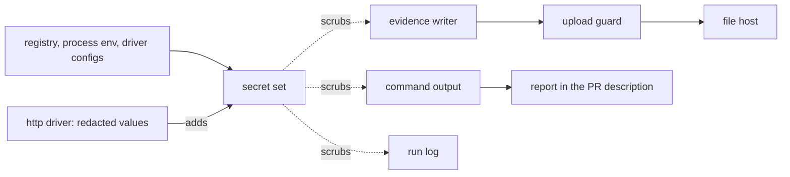

# Redaction

This doc uses the words the [terms](../reference/terms.md) page defines: registry, target, driver,
command, feature, run, doctor, evidence and report.

A run writes what it sees into `.wringer/`: request headers, cookies, URLs, log lines, database rows
and screenshots. Some of it leaves the machine:

- Each command's step data, the data it returned, can reach the report in the PR description.
- Evidence files reach the repo's file host behind public links, only when the target sets
  `evidence: 'upload'`.

To keep secrets out of both, `@wringer/core` replaces each secret value it knows in the text wringer
writes. The few run log events that keep their values are the exception, as
[Events that keep their values](#events-that-keep-their-values) says. Each driver also redacts by
structure, for a credential that core doesn't know yet: the http driver, for example, redacts every
cookie's value whatever it holds.

[PR report](./pr-report.md) covers how the report and the evidence reach the PR.

## What is public

An attacker can read each of these for as long as its link or its log lives:

- the PR description;
- each uploaded file, through its link;
- the CI log of a public repo, and anything a run prints to stdout in CI.

wringer uploads only files from a run's `features` folder, `.wringer/runs/<run_id>/features/`, which
holds each feature's evidence. Everything else in `.wringer/` stays on the machine, such as the
app's own log, `supervisor.log` and the stream driver's recordings of the app's output.

wringer doesn't defend against these:

- an attacker who can read the machine's disk;
- a registry written to leak on purpose;
- a secret that the app itself shows on a page, on a target that uploads its evidence.

## The secret set

Each command builds a secret set from the secrets the registry declares, the process env and the
driver configs. A driver adds each secret it learns at runtime, such as a session cookie, before it
writes any evidence that holds it.

The scrubber replaces each secret wherever it appears in a text, in each of these spellings:

- as written;
- JSON-escaped;
- URL-encoded and form-encoded;
- base64 and base64url, of the secret's leading bytes in whole groups of 3, so a secret inside a
  larger base64 text matches when it starts on a group boundary.

`@wringer/core` scrubs at four places, so a command that the repo adds needs no redaction code:

- the evidence writer, which scrubs a file's whole content in one pass, so a secret never splits
  across two chunks;
- each command's JSON result, as a whole;
- each event that a streaming command prints, before it reaches stdout;
- each event appended to the run log.

A run's commands are separate processes, so a secret that one command learns has to reach the next.
Each process appends the secrets it adds to the run's `secrets.ndjson`, which wringer creates with
mode 0600 and writes under the run's file lock. Every command that reads a run loads that file
first. `@wringer/core` deletes the file at `down` and `detach`, and when `up` or `attach` starts a
new run in the old run's place. A command that still runs after its run ended appends nothing to the
file, so the file never comes back. The file never goes into evidence, a report or an upload.

The scrubber skips these values:

- an env value of digits only;
- an env value that is a URL with no password;
- a value under 4 characters, which would match all over the evidence and protect nothing. Only the
  driver's structural redaction covers it.

A value of 4 to 7 characters matches only where no letter or digit sits on either side. The scrubber
also misses a secret in hex, inside a hash, inside compressed bytes, and inside a larger base64 text
where the secret doesn't start on a group boundary.

## Events that keep their values

A few run log events keep their values unscrubbed, because a later command reads them back and
compares them: the run's endpoints, its feature names, and the deployed commit that the doctor
reads. Before it writes such an event, `@wringer/core` checks the value for any spelling of a known
secret:

- When an endpoint holds a secret, or holds a username and password in its URL, the supervisor ends
  the run, and `up` or `attach` fails with the `environment` error.
- When a feature name holds a secret, `up` and `attach` fail with the `usage` error before the run
  starts.
- When the deployed commit holds a secret, the doctor's revision check fails with the `usage` error,
  and the error message gives only the value's type or length.

## The upload guard

The upload guard checks each file just before it leaves the machine. It keeps the file local, with
no link in the report, when the file:

- is missing;
- sits outside the run's `features` folder once symlinks resolve;
- isn't a regular file;
- changed since the evidence writer hashed it;
- is a screenshot or a video from a target without `evidence: 'upload'`.

`publish` already uploads nothing from a target without `evidence: 'upload'`. The guard's own check
on screenshots and videos is a second line, because wringer can't scrub them.

The guard scrubs with a secret set that also loads the secrets file of every run the report's
verdicts name, so it can know a secret that the evidence writer didn't know yet. When it finds a
secret in a text file, it fails the whole command before any file is sent, because the same secret
may sit in step data too.

wringer can't scrub a screenshot or a video. A repo sets `evidence: 'upload'` on a target only when
the target's pages hold no real secrets, such as seeded data and test accounts with no real access.

Before `publish` writes the description, it searches the rendered report for each secret's
spellings, and fails when it finds one.

## The http driver

The http driver redacts by structure, in its evidence and its error messages:

- the value of each credential header, such as `authorization`;
- each cookie's value, keeping the cookie's name;
- the value of each credential query parameter, also in a `location` or `referer` header, because a
  redirect can carry an OAuth `code`;
- each string under a credential JSON body path.

The driver has a default list of credential headers, query parameters and body paths. A repo adds to
each list with the `headers`, `query` and `bodyPaths` keys of the driver's `redact` config. Each
value the driver redacts also joins the secret set, so the scrubber replaces a copy of the value
anywhere else. A request with `evidence: false` writes no evidence file, but the driver still adds
its secrets to the set.

The driver refuses a request whose URL holds a username or a password. Bun's fetch sends them as
Basic auth, so stripping them would change what the app sees, and keeping them would put the
password into every logged URL. Send credentials as a header built from a secret that the registry
declares.
