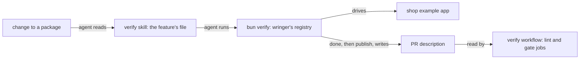

# Self-verify

This doc uses the words the [terms](../reference/terms.md) page defines: registry, target, action,
command, doctor, feature, journey, verdict, evidence, report, gate, shared glob and ignore list.

wringer verifies its own changes with its own verify CLI. The root `bun verify` runs wringer's own
registry, whose features cover wringer's packages: one per driver package, `core`, `cli` for the
source of `@wringer/gunshi`, and `guide` for the guide text that `@wringer/gunshi` ships. To verify
a change, an agent follows the feature's journey: it runs wringer's commands against the shop
example, a small app in `packages/shop-example/`, and checks the end state. Every PR carries a
report, and the `gate` job in CI fails the PR unless each changed feature has a verdict on its
current code.

[Verdicts and the gate](./verdicts.md) covers the verdicts, and [PR report](./pr-report.md) covers
how they reach the PR.

## wringer's registry and the shop's

wringer has two registries over the same tree:

- **wringer's own registry**, which the root `bun verify` runs. It lives in the shop example
  package, because it reuses the shop's targets, its seed action and its doctor check. That package
  is private, so the registry ships to no one.
- **The shop's registry**, the example that a repo copies to start its own. Its features cover only
  the shop app, and its ignore list holds every path outside the shop example.

In wringer's registry, each driver package, such as `@wringer/http`, is one feature. `core` is one
feature too. Its source sits in one flat folder, so a split into several features would need a glob
per file name, and each new file would then match no feature. The ignore list holds tests, test
utils, docs, `.claude/` and `scripts/`, so a change limited to them leaves every verdict standing.

`bun verify lint` reads the registry and the git file list. It fails on each file that git tracks
and that matches no feature's `paths`, no shared glob and nothing in the ignore list, so every new
folder belongs to a feature or is ignored on purpose. Both registries cover every file in the tree,
so `lint` passes for each.

wringer's `local` target uploads its evidence to the file host in `CLOUD_FILES_URL`, so a reviewer
can open each file from the PR. The shop's `local` target keeps its evidence on the machine, the
default for a repo's first registry.

## The skill and the guide

An agent verifies each feature from wringer's verify skill, in `.agents/skills/verify/`. The skill
has one `references/feature-<name>.md` file per feature, with that feature's journey. `lint` also
reads the skill folder, and starts no run. It fails in each of these cases:

- a feature has no feature file;
- a feature file matches no feature;
- a feature file lacks its `## Journey` or `## End state` section;
- a journey's first command isn't `bun verify use --feature <name>`, which sets the feature that
  later commands, such as `done`, act on when they get no `--feature`.

Keep the feature list in the skill's `SKILL.md` between two markers.
`bun verify features --markdown` prints the list that belongs there, and `lint` fails when the
skill's list differs from it.

The guide is the text that teaches a repo how to build its verify CLI and its verify skill, and it
ships in `@wringer/gunshi`. `bun verify guide` prints it from the installed package, so the text an
agent reads always matches the installed version. The guide holds a template for a repo's verify
skill. A repo's skill records the template it came from as a content hash in the
`metadata.wringer-template` line of its frontmatter. When that hash differs from the installed
template's hash, `lint` fails, gives the installed hash, and tells the agent to run
`bun verify guide template`, which prints the path of the installed template folder. An edit to the
template changes the hash, so after a release that edits the template, `lint` fails in every repo
that uses wringer until its skill is upgraded.

The shop's verify skill sits in `packages/shop-example/verify-shop/`. It's the worked example of the
template, and `verify-shop.test.ts` runs the shop's `lint` over it. Agents in this repo load only
wringer's own verify skill.

## The CI jobs

The verify workflow runs two required jobs on every PR, `lint` and `gate`, with no path filter. The
workflow holds no secret, and its token has read access to contents and pull requests and nothing
else, so it runs the same way on a PR from a fork. Every value from the event, such as the PR
number, reaches a script through `env:`, and never through a `${{ }}` expression inside a `run:`
step.

The `gate` job runs `bun run ci:verify-pr`, the same script that an agent runs to check that a PR's
verification is done. The script reads the PR description with `gh pr view`, never from the event
payload, so a rerun reads the current text. It runs these checks in order, and stops at the first
that fails:

1. the branch has a PR;
2. the description holds a report;
3. the report names wringer's registry;
4. `bun verify gate` passes.

The script exits 2 when it can't run, such as when `gh` is missing or the base branch isn't fetched,
so a broken setup never reads as a failed verdict.
