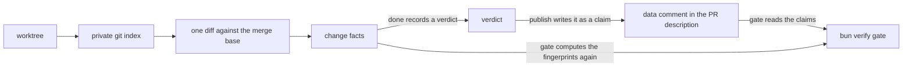

# Verdicts and the gate

Read the [terms](../reference/terms.md) page for the words this doc uses: registry, target, command,
feature, journey, run, doctor, verdict, fingerprint, evidence, report, gate, shared glob and ignore
list.

An agent that changed a feature drives its journey on a running app, then runs `bun verify done`,
which records a verdict for the feature. In CI, `bun verify gate` checks that every feature the
branch changed has a verdict on the code the branch holds now. wringer ties each verdict to that
code through the feature's fingerprint, a hash of the feature's part of the branch diff. When the
fingerprint that `gate` computes differs from the one in the verdict, the verdict is stale.

For how the verdicts reach the PR description, see [PR report](./pr-report.md). For the secrets that
evidence must never hold, see [Redaction](./redaction.md).

## Change facts

wringer reads the branch in one function, `readChangeFacts`, and every command that needs the branch
calls it, such as `up`, `done`, `publish` and `gate`. It returns the change facts:

- the merge base with the PR's base branch;
- the changed paths;
- one fingerprint of the whole diff, which a run and the report record;
- one fingerprint per feature.

All of them come from one diff of one index, so the changed paths and the fingerprints always
describe the same files.

wringer builds that index in a git folder of its own, under git's default config. It starts from a
copy of the repo's own index, then runs `git add --all`, so every file on disk counts unless the
repo's `.gitignore` hides it. wringer never reads the clone's `info/exclude`, the user's global
excludes, or their attributes and filters, so two clones of the same change get the same
fingerprint. A sparse checkout, a linked worktree, a shallow clone and a detached `HEAD` give the
same fingerprint too. A file that only `info/exclude` hides therefore counts as changed. An
exception is a clone whose git config rewrites files as git adds them, such as with `core.autocrlf`.
The copy of that clone's index holds the rewritten bytes of each file the clone has added, so the
fingerprint can change once the change is committed, and the verdict then reads as stale.

Before the diff, wringer resets each changed path that the ignore list matches, and that no
feature's `paths` or shared glob matches, to its content at the merge base. A doc that only the
ignore list matches therefore drops out of the changed paths and out of every fingerprint. wringer
then splits the diff into one part per path. A feature's fingerprint is `git patch-id --verbatim`
over the parts whose path matches the feature's `paths` or a shared glob, or `empty` when no part
matches. `patch-id` hashes the changed lines together with the lines around them. A commit of the
same change keeps the fingerprint, and so does a rebase that leaves the surrounding lines alone. A
rebase that changes them changes the fingerprint. wringer needs git 2.39 or later, the first release
with `--verbatim`.

## Staleness

Apart from the clone that rewrites files, a verdict goes stale only when a file in its feature's
`paths` or a shared glob changes. An edit to one feature's files leaves every other feature's
verdict standing. A change to a shared glob changes every feature's fingerprint, so list as shared
globs only the files that affect every feature's behaviour, such as the lock file.

wringer never makes the registry's own file a shared glob by itself. Each shared glob sits in the
registry, where a reader can see it and see why every verdict went stale. To keep the registry's
file covered, `lint` fails when that file matches no feature's `paths` and no shared glob.

`gate` fails each changed path that matches no feature's `paths`, no shared glob and nothing in the
ignore list.

## Recording a verdict

`done` records a verdict for a feature only when the agent drove that feature on the current run. A
command counts for the feature when all of these hold:

- it ran after the doctor passed;
- it succeeded;
- it touched the app, as a driver command does, or the feature's `commands` list names it.

When a feature's journey never touches the app, list the commands that check it in `commands`.
wringer's own `guide` feature, which checks the guide text the CLI prints, is one. A command that
another feature's `commands` list names never counts for this feature.

A launch target is one that `up` starts, such as the app on the agent's machine. When the run
starts, it records each feature's fingerprint. When a feature's fingerprint changes during the run,
the running app was built from other code, so `done` refuses the verdict and tells the agent to run
`up --restart`.

An attach target is one that `attach` reaches without starting it, such as a deployed preview. It
can set `revision`, a function in the registry that returns the commit the deployment runs. The
doctor calls `revision` once as one of its checks, and `done` calls it again. `done` refuses the
verdict in each of these cases:

- the two calls return different commits;
- the clone lacks the commit;
- a file in the feature's `paths` or a shared glob differs between that commit and the worktree.

Otherwise `done` stores the commit in the verdict, and the verdict is pinned. `done` compares only
the feature's files between the commit and the worktree, so `HEAD` need not be the deployed commit,
and an uncommitted edit to other files never blocks the verdict. On an attach target without
`revision`, `done` records an unpinned verdict. `gate` accepts an unpinned verdict unless the
registry sets `.gate({ unpinned: 'refuse' })`.

## The data comment and the gate

The report that `publish` writes into the PR description ends with the data comment, an HTML comment
that starts with `<!-- wringer-data v2 `. It holds one claim per feature: the verdict's feature,
fingerprint, target and pin. A claim never holds evidence links, which sit in the report's tables,
so a verdict with many evidence files never makes the PR description longer than GitHub allows.
Every field of version 2 is required, so `gate` fails a comment that lacks a field or adds one.

`gate` reads only the claims from the PR description. It computes every fingerprint and every
unmapped path itself, from the checkout and the registry that CI runs, and gives each changed
feature one status:

| Status     | When                                                                                                       | `gate` |
| ---------- | ---------------------------------------------------------------------------------------------------------- | ------ |
| `verified` | the claim's fingerprint equals the computed one, and the policy allows it                                  | passes |
| `unpinned` | the fingerprints are equal, the verdict is unpinned, and the registry sets `.gate({ unpinned: 'refuse' })` | fails  |
| `stale`    | the claim's fingerprint differs from the computed one                                                      | fails  |
| `missing`  | the feature changed and has no claim                                                                       | fails  |

A feature whose computed fingerprint is `empty` didn't change, so `gate` passes it, whatever its
claim holds. `gate` fails a version 1 comment whole, because it holds no fingerprint per feature.

`gate` trusts every claim that parses. Anyone who can edit the PR description can write a claim, and
anyone can compute a fingerprint from the branch alone. `gate` therefore shows that an agent
followed the workflow, and can't stop someone with write access who means to skip it.
