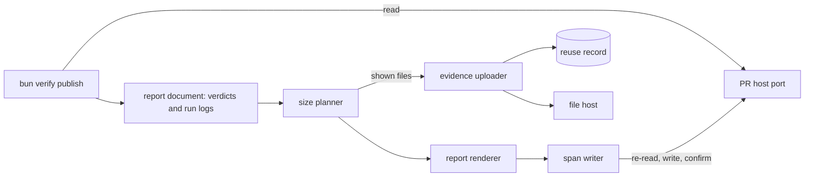

# PR report

- **Status:** draft

A reviewer reads a PR's verification as a pasted `report --human` block today. That block is a flat
table that escapes only `>`, and `report` uploads every evidence file each time anyone runs it.
`bun verify publish` becomes the one command that writes the report into the PR description, through
a PR host port and a generic evidence uploader. The report gets a summary table and one journey
table per verified feature, planned in one pass to fit GitHub's limit on the description's length.

## Shape



## Contracts

### The `publish` command

```ts
// bun verify publish [--base <ref>] [--pr <number>] [--dry-run] [--no-upload]
// → { ok: true, command: 'publish', data: {
//      pr: { number: 412, url: 'https://github.com/acme/shop/pull/412' },
//      action: 'replaced', uploaded: 2, reused: 3, local: 0,
//      cuts: { droppedData: 4, collapsed: 1, shortCells: 0, omitted: 0 },
//      dryRun: false } }
```

```ts
// core: verdict commands
const publishArgsSchema = z.strictObject({
  base: z.string().min(1).optional(), // default: the PR's base branch, `origin/<base>` when the clone has it, else `<base>`
  pr: z.number().int().positive().optional(), // skips the branch lookup
  dryRun: z.boolean().default(false), // reads the PR and plans; uploads nothing, writes nothing
  upload: z.boolean().default(true), // `--no-upload`: every journey keeps its evidence local
});

const publishDataSchema = z.strictObject({
  pr: z.strictObject({ number: z.number().int(), url: z.string() }),
  action: z.enum(['created', 'replaced', 'unchanged']), // `unchanged`: the span already held this block
  uploaded: z.number().int().nonnegative(),
  reused: z.number().int().nonnegative(), // links taken from the reuse record
  local: z.number().int().nonnegative(), // shown files that stayed local
  cuts: reportCutsSchema, // how many of each cut the size plan took
  dryRun: z.boolean(),
  markdown: z.string().optional(), // the block, on a dry run only
});

// The spec declares `effect: 'write'` and `touchesTarget: false`. `publish` writes to the PR and
// the file host, never to the target, so it needs no run and runs on a read-only target.
interface BuiltinCommandSpec<Args, Data> {
  // …existing fields
  readonly touchesTarget?: boolean | undefined; // default true; false skips the target's access check
}
```

`report` keeps its arguments and its data shape, and stops uploading. `report --human` prints the
same block that `publish --no-upload` writes, so a person can preview it.

### The report span

```ts
// core. Pure: the description in, the description with the block in place out.
const edited = writeReportSpan(body, block);
// → { ok: true, body: '…## Verification\n\n- [x] …\n\n<!-- wringer:report -->…', action: 'created' }
//   or { ok: false, reason: 'The description holds 2 opening wringer report markers; it must hold one.' }

export const reportMarkers = {
  open: '<!-- wringer:report -->',
  close: '<!-- /wringer:report -->',
} as const;

type ReportSpanEdit =
  | {
      readonly ok: true;
      readonly body: string;
      readonly action: 'created' | 'replaced' | 'unchanged';
    }
  | { readonly ok: false; readonly reason: string };
```

### The PR host port

```ts
// core: types. Adapter: GitHub over its REST API with `fetch`; a GitLab adapter implements the same
// interface. Tests use an in-memory fake.
interface PullRequestHost {
  // `branch` is the current branch; `number` comes from `--pr`.
  readonly findOpen: (
    request: { branch: string } | { number: number },
  ) => Promise<PullRequestFound>;
  readonly readBody: (number: number) => Promise<PullRequestView>;
  readonly writeBody: (number: number, body: string) => Promise<void>;
}

type PullRequestFound =
  | { readonly kind: 'one'; readonly pr: PullRequestView }
  | { readonly kind: 'none' }
  | { readonly kind: 'many'; readonly numbers: readonly number[] };

interface PullRequestView {
  readonly number: number;
  readonly url: string;
  readonly body: string; // GitHub returns `null` for an empty description; the adapter gives ''
  readonly baseBranch: string;
  readonly state: 'open' | 'closed' | 'merged';
}

interface Session {
  // …existing fields
  readonly pullRequests: PullRequestHost;
}
```

The CLI adapter builds the GitHub port at the entry point:

- The repo is the `owner/name` of the `origin` remote's URL, in its HTTPS or SSH form.
  `GITHUB_REPOSITORY` overrides it.
- The API base is `GITHUB_API_URL`, or `https://api.github.com`.
- The token is `GITHUB_TOKEN`. Without it, the adapter runs `gh auth token` and uses its stdout when
  it exits 0. It reads no stderr.
- `findOpen` with a branch lists
  `GET /repos/{owner}/{name}/pulls?state=open&head={headOwner}:{branch}`. `headOwner` is the owner
  of the branch's push remote, from `branch.<name>.pushRemote` or `branch.<name>.remote`, else
  `origin`, so a branch pushed to a fork finds its PR.
- `writeBody` sends `PATCH /repos/{owner}/{name}/pulls/{number}` with `{ body }`.
- `findOpen` with a number reads `GET /repos/{owner}/{name}/pulls/{number}` and returns that PR in
  any state, so the caller checks `state`. `state` is `merged` when GitHub gives a `merged_at` time.
- The adapter reads the repo and the token on its first request, so a command that touches no PR
  needs neither. A repo it cannot read from `GITHUB_REPOSITORY` or `origin` fails with
  `environment`, and the message never repeats the remote URL, which can hold a password.
- Every failure the port reports has the code `environment`. A network failure and a status the list
  below leaves out give a fixed message with no response text.
- The port sends the token only to an `https` API URL, or one on a loopback host. It does not follow
  a redirect, which would carry the token to another place, and it fails on a token that is not a
  valid header value without echoing it.

### The evidence uploader

```ts
// core: types. Replaces `HookHandlers.upload` and `UploadRequest`.
interface HookHandlers {
  readonly upload: EvidenceUploader;
}

interface EvidenceUploader {
  readonly maxURLLength: number; // the link's length once percent-encoded and HTML-escaped; core rejects a longer one
  readonly linkHosts: readonly string[]; // the hosts core accepts in a returned link
  readonly assertReady?: () => void; // throws `environment`, naming the variable, when its configuration is missing
  readonly upload: (file: UploadFile, signal: AbortSignal) => Promise<UploadedLink>;
}

interface UploadFile {
  readonly bytes: Uint8Array;
  readonly filename: string; // core builds it: `[A-Za-z0-9._-]`, 100 characters at most
  readonly contentType: string; // core picks it from the extension; see Constraints
  readonly label: string; // `<registry name>/<feature>`
  readonly sha256: string;
}

interface UploadedLink {
  readonly url: string;
  readonly expiresAt: string | null; // ISO time; null for a link that never expires
}

interface TargetBase<Ds extends AnyDrivers> {
  // …existing fields
  // default 'local'. 'upload' puts this target's evidence files and step data in the PR description,
  // which anyone who can read the repo can read.
  readonly evidence?: 'upload' | 'local' | undefined;
}
```

Core ships an uploader for a file host that takes a multipart POST with a bearer token. The registry
passes the names of the environment variables, never their values:

```ts
const wringer = createWringer({ name: 'shop' })
  .target('preview', { mode: 'attach', access: 'read-only', evidence: 'upload', host: local() })
  .hook(
    'upload',
    createHostUploader({ urlEnv: 'VERIFY_UPLOAD_URL', tokenEnv: 'VERIFY_UPLOAD_TOKEN' }),
  )
  .build();

// core
interface HostUploaderOptions {
  readonly urlEnv: string; // the upload endpoint, an https URL
  readonly tokenEnv: string;
  readonly expires?: string | undefined; // the host's `expires` field; default '30d'
  readonly maxURLLength?: number | undefined; // default 512
}
// POST <url> with fields `file`, `label`, `expires`; `Authorization: Bearer <token>`.
// The host returns 201 with JSON `{ url, expiresAt }`. linkHosts is the upload URL's host.
// The uploader reads both variables when it is used, so a command that never uploads needs neither.
// `readSecrets` returns the token, named for its variable, and core adds it to the command's secret
// set after `assertReady`, so the scrubber and the upload guard know it whatever the variable is
// named.
// `linkHosts` and `assertReady` read the URL, and `assertReady` also reads the token. The URL is
// `https`, or `http` on a loopback host. The request never follows a redirect.
```

### The reuse record

```text
<stateDir>/uploads.json, one object keyed by `<host> <sha256>.<extension>`, where `<host>` is the uploader's first `linkHosts` entry:
  url        string   the link the host returned
  expiresAt  string?  ISO time from the host; absent for a link that never expires
  uploadedAt string   ISO time of the upload
```

### The report

The verdict-scope doc owns the [data comment](./verdict-scope.md#data-comment) inside the span, and
the verdict record the renderer reads. The renderer owns the rest of the span, in this order:

1. The opening marker.
2. The summary table: one row per feature, with the columns Feature, Status, Target and Journey ("6
   commands, 4 s"). Target shows the verdict's target name, and the first 7 characters of its
   deployed revision when the verdict's pin is `deployed`.
3. One line naming the changed paths no feature maps, when the report has any.
4. One collapsed `<details>` section per verified feature, holding its journey table and, when
   evidence stayed local, a note.
5. The data comment from `renderReportComment`, then the closing marker.

Each journey table is an HTML table with the columns #, Command, Result and Evidence, and a Data
column when a shown row has data:

````html
<tr>
  <td>3</td>
  <td><code>browser screenshot</code></td>
  <td>ok, 550 ms</td>
  <td></td>
  <td></td>
</tr>
<tr>
  <td>4</td>
  <td><code>http get</code></td>
  <td>ok, 41 ms</td>
  <td></td>
  <td>```json { "status": 200, "items": 2 } ```</td>
</tr>
````

```ts
// core. Pure: the same document and plan always give the same text. `report` renders with the plan
// `noCuts`. Both take the command's secret set last, to scrub each value.
const block = renderReport(document, plan, secrets);

interface ReportDocument {
  readonly registry: string; // the `createWringer` name, for the data comment
  readonly linkHosts: readonly string[]; // the uploader's `linkHosts`; empty while nothing uploads
  readonly report: Report; // the verdict-scope report
  readonly journeys: ReadonlyMap<string, Journey>; // by feature: each feature whose status is `verified`
}

interface Journey {
  readonly steps: readonly JourneyStep[]; // the drives that `done` counted, in order; never `use`
  readonly evidence: 'upload' | LocalCause;
}

type LocalCause =
  | 'target-local'
  | 'recorded-local'
  | 'target-gone'
  | 'no-upload-flag'
  | 'run-log-missing';

interface JourneyStep {
  readonly command: string;
  readonly ok: boolean;
  readonly code: string | null; // the error code of a failed step
  readonly durationMs: number;
  readonly files: readonly JourneyFile[];
  readonly data: unknown; // the envelope's data
}

interface JourneyFile {
  readonly evidence: Evidence; // kind, path, sha256
  readonly bytes: number | null; // null when the file is gone from the worktree
  readonly url: string | null; // null from the document reader; publish builds a new document with the links
}

// core. Pure: one pass over fragment sizes, no render loop.
// budgetChars: the span's budget from Size; planReport counts the markers and the data comment in it.
// linkChars: the uploader's maxURLLength, or 0 with `--no-upload` or `--dry-run`. A file that fails
// the upload checks is sized as a local cell in every plan.
const result = planReport(document, { budgetChars: 61_200, linkChars: 512 }, secrets);
// → { ok: true, plan: { cuts: { droppedData, collapsed, shortCells, omitted }, features }, chars: 58_911 }
//   or { ok: false, minimumChars: 66_034 }
// `features` holds each feature's cuts by name, for the renderer. `collectShownFiles(document,
// plan, linkChars)` returns the files the plan shows as links, which `publish` uploads.
```

## Constraints

### Publish

- `publish` runs these steps in order:
  1. Read the PR, and plan against its description.
  2. Upload the files that plan shows.
  3. Read the description again, and plan against it. This plan shows no file that step 2 did not
     upload, as [Size](#size) says.
  4. Render, write, and read the description once more to confirm the span holds the block it wrote,
     comparing with line endings turned to LF.
- When the confirming read finds another span, another writer replaced the block after the write.
  `publish` fails with `check-failed`, says that its block is gone and the other span stands, and
  hints "run `publish` again".
- An edit that lands between the second read and the write is lost: GitHub's PR update takes no
  version check. The window is one request long.
- `publish` has a default timeout of 300 s, which `--timeout-ms` overrides. Past the deadline, it
  skips the write. Any failed upload fails it before the write, and the description stays as it was.
  Each link uploaded before the failure stays in the reuse record, so a retry reuses it.
- `--dry-run` makes no upload and no write. It prints the block with local evidence, counts in
  `uploaded` the files that would upload, and needs the PR token but no upload variables.
- When the current branch has no open PR, `publish` fails with `environment` and the hint to open
  the PR or pass `--pr`. When it has several, the error lists their numbers.
- On a detached HEAD, `publish` needs `--pr`. A PR named by `--pr` that is closed or merged fails
  `publish` with `environment`. With no token from `GITHUB_TOKEN` or `gh auth token`, `publish`
  fails with `environment` before any upload.
- The port maps HTTP 401 to "the token is not valid", 403 and 404 to "the token cannot reach this
  PR", and 422 on the write to "GitHub refused the description". No error carries the token or a
  response body.

### The span

- `writeReportSpan` keeps every byte outside the span. The block takes the description's line
  ending: CRLF when the description holds one, else LF.
- A marker or a `## Verification` heading inside a fenced code block is the author's text, and
  `writeReportSpan` skips it.
- When the description holds one span, `writeReportSpan` replaces it where it stands.
- When it holds none, the span goes at the end of the `## Verification` section, before the next
  heading of level 2 or less, with a blank line on each side.
- When it holds no `## Verification` heading, `writeReportSpan` appends one at the end, with the
  span under it.
- When it holds more than one opening or closing marker, or a closing marker before the opening one,
  `publish` fails with `check-failed` and writes nothing.
- When it holds an opening marker with no closing one, or the reverse, `publish` fails the same way.
- `writeReportSpan` takes a block that starts with its one opening marker and ends with its one
  closing marker, and refuses any other block, including one whose closing marker falls inside a
  fenced code block. It trims the block's outer whitespace.
- `writeReportSpan` uses the first `## Verification` heading outside a fenced code block. A heading
  matches with up to 3 spaces of indent and optional closing hashes. A code fence is a run of 3 or
  more backticks or tildes, indented by up to 3 spaces, closed by a run of the same character at
  least as long. A code fence that never closes runs to the end of the description, and
  `writeReportSpan` refuses to put a new span inside it.
- When the description holds one span and it already equals the block, with line endings turned to
  LF, `writeReportSpan` returns the description untouched with `action: 'unchanged'`.

### Rendering

- `renderReport` scrubs each value with the command's secret set, then HTML-escapes `&`, `<`, `>`,
  `"`, `'` and the backtick in every value from the registry, a run or a verdict, and collapses its
  whitespace to one space.
- A Command cell keeps only the command path, with its segments joined by spaces, in `<code>`, with
  each backtick, `<` and `>` dropped.
- A link in the report is `https`, its host is in the uploader's `linkHosts`, and the renderer
  percent-encodes each space, quote, `<`, `>`, `(`, `)`, backtick, `\` and `|` in it.
- An Evidence cell shows a raster image (`png`, `jpg`, `jpeg`, `gif`, `webp`) as
  ``, and any other file as a link named by its evidence kind. A local file shows
  its name and size, or "(missing)".
- Step data is pretty-printed JSON in a `json` code block. Each `<`, `>` and backtick becomes its
  JSON `\u` escape, so the data reads back the same and cannot close its code block, its cell, the
  span or a comment.
- Step data longer than 2,000 code points is cut at a code point boundary and ends with "… cut at
  2,000 characters".
- Step data shows only when the journey's evidence uploads.
- Before it shows, step data has the value of every key that matches
  `/token|secret|api-?key|session|passw|authorization|cookie/i`, at any depth, replaced by
  `"[redacted]"`, and the user and password of every URL in a string removed.
- A step with no data, empty data, or data that is one evidence item of that step shows no data. A
  table with no shown data leaves out its Data column.
- `report` builds the document with no upload, so a journey that would upload carries the cause
  `no-upload-flag`. When more than one cause holds, the note names the first of: `run-log-missing`,
  `recorded-local`, `target-gone`, `target-local`, `no-upload-flag`.
- A journey whose evidence stays local carries one note naming its cause, from this table:

| Cause             | The note gives                                                     |
| ----------------- | ------------------------------------------------------------------ |
| `target-local`    | the target, and `evidence: 'upload'` as the setting to change      |
| `recorded-local`  | that the verdict was recorded while its target kept evidence local |
| `target-gone`     | that the verdict's target is no longer in the registry             |
| `no-upload-flag`  | `--no-upload`                                                      |
| `run-log-missing` | that the run log is gone, so the journey has no rows               |

### Upload

- A journey uploads when `--no-upload` is absent, the verdict's target had `evidence: 'upload'` when
  `done` recorded it, and the registry's target of that name still has it.
- Before any upload, every shown file passes the upload guard that
  [Redaction](./redaction.md#the-upload-guard) owns. A file the guard refuses stays local, and a
  `secret-found` refusal fails `publish` before the first upload, as that design says.
- `publish` uploads only the files the final plan shows.
- When a target has `evidence: 'upload'` and the registry has no `upload` hook, `lint` fails, and
  `publish` fails with `usage` before it reads the PR.
- A missing upload URL or token variable fails `publish` with `environment`, naming the variable.
  `lint` checks no environment.
- Core calls `assertReady` before it reads a file or sends one, so a missing variable fails before
  the first upload.
- Core sends only the bytes whose SHA-256 is the one the guard checked: it reads the file again at
  the upload and refuses a file that changed since. A filename that holds a known secret becomes
  `<sha256>.<extension>`, and the label is scrubbed with the command's secret set.
- A reuse record entry that fails the link checks, or a record that does not parse, is not reused.
  Core uploads at most 4 files at once, and records each link when the host returns it.
- Core picks the content type: `image/png`, `image/jpeg`, `image/gif`, `image/webp`, `video/mp4` and
  `video/webm` by extension, `text/plain` for every other text file, including HTML, SVG, Markdown
  and XML, and `application/octet-stream` for the rest.
- Core rejects a returned link that is not `https`, whose host is not in `linkHosts`, or whose
  rendered form, percent-encoded and HTML-escaped, is longer than `maxURLLength`, and fails
  `publish` with `environment`.
- `publish` reuses a link from the reuse record while it has 7 days or more before `expiresAt`, and
  uploads the file again otherwise.
- `publish` reads and writes the reuse record under `withFileLock`. It never takes a link from the
  PR description.
- The reuse record lives in the state folder, which the fingerprint and the changed paths already
  leave out.

### Size

- GitHub refuses a description longer than 65,536 characters. The budget for the span is 65,536,
  less the characters outside the span after the line-ending change, less a margin of 1,024.
- The data comment's size does not depend on the evidence count, so the planner cuts only the human
  part.
- `planReport` computes each fragment's size once, then takes cuts in this fixed order until the
  total fits:
  1. Drop step data, the largest block first; a tie drops the later step first.
  2. Collapse each journey table of 12 rows or more to its first and last 5 rows, the longest table
     first.
  3. Cut each Evidence cell of 4 files or more to 3, images first, the cell with the most files
     first.
  4. Replace a feature's journey section with one line naming its command count, the longest section
     first.
- A collapsed table keeps a row that names how many steps it leaves out, and a cut cell ends with
  "+N more". A cut cell keeps the images first and shows its files in their own order. A file is
  sized as a link when its journey uploads, `linkChars` is above 0 and the file is present in the
  worktree; every other file is sized as a local cell. A cut that changes nothing, such as a cell in
  rows the collapse hid, is skipped and not counted. So is a cut that makes its section longer, such
  as the one-line replacement of a journey with no steps, so the smallest size the planner reports
  never exceeds the uncut size.
- The renderer builds the span from those fragments, so the rendered length equals the planned
  length when every link is `maxURLLength` long, and is shorter otherwise.
- The cut order does not depend on the budget, so a smaller budget only adds cuts. The second plan,
  against the re-read description, never shows a file the first plan did not upload.
- When the summary table, the data comment and the shorter form of each section still do not fit,
  `publish` fails with `check-failed`: "The report needs 66,034 characters, and the PR description
  has room for 61,200 of GitHub's 65,536." `report --human` prints the uncut block and never fails
  on size.

## Decisions

- **`publish` is the only command that uploads or writes the PR.** `report` stays a pure read that
  agents run often.
- **The PR host port is an interface, with a GitHub REST adapter.** HTTP status codes classify
  failures, where a CLI's stderr text changes between releases.
- **Upload reuse trusts only a local record.** Anyone who can edit the description could plant a
  link in it.
- **The size plan is one pass over fragment sizes.** A plan known before any upload uploads nothing
  it later cuts, and needs no rehearsal with fake links.
- **Every table is HTML.** One escaping rule covers every cell, and a code block fits in an HTML
  cell.

## Builder decides

- Internal names and files, how `planReport` stores fragment sizes, and the wording of each error
  and note.
- How many uploads run at once.

## Out of scope

- Deleting links from the file host. Links expire on their own.

## Open questions

- **What does GitHub count in its 65,536-character limit?** A measurement settles it: write
  descriptions of known UTF-16 and code point lengths with emoji and CRLF. Until then, the planner
  counts UTF-16 code units and keeps the 1,024-character margin.
- **Does GitHub render a code block inside an HTML table cell in every client?** A check on a
  throwaway PR in the web UI and the mobile app settles it. Until then, the renderer puts a blank
  line on each side of the code block.

## Work items

Each item is one PR. Two work items in [verdict-scope](./verdict-scope.md) come first: "Scope
verdicts to their feature", which records `target.evidence` in the verdict, and "Write and gate the
version 2 data comment", which `renderReport` places with `renderReportComment`. `publish` resolves
each journey's target from its verdict and ignores `--target`.

### The report span writer

- **Outcome:** `writeReportSpan` puts a block into a PR description by the rules in
  [The span](#the-span).
- **Depends on:** nothing.
- **Acceptance:**
  - [ ] Every byte outside the span stays, for LF and CRLF descriptions. Evidence: `writeReportSpan`
        tests.
  - [ ] Markers and headings inside code blocks are skipped, and broken marker sets are refused.
        Evidence: `writeReportSpan` tests.

### The PR host port and its GitHub adapter

- **Outcome:** `Session.pullRequests` reads and writes a PR description over GitHub's REST API, by
  [The PR host port](#the-pr-host-port).
- **Depends on:** nothing.
- **Acceptance:**
  - [ ] The adapter finds one, none or many open PRs for a branch, and maps 401, 403, 404 and 422 to
        their errors. Evidence: adapter tests against a local HTTP stand-in.
  - [ ] The token comes from `GITHUB_TOKEN`, then `gh auth token`, and appears in no error.
        Evidence: adapter tests.

### The evidence uploader

- **Outcome:** a registry uploads evidence through `createHostUploader` or its own
  `EvidenceUploader`, with the core checks and the reuse record in [Upload](#upload).
- **Depends on:** redaction's "Scrub every known secret at core's sinks", which builds the upload
  guard.
- **Acceptance:**
  - [ ] `createHostUploader` sends the multipart fields and reads `url` and `expiresAt`. Evidence:
        uploader tests against a local HTTP stand-in.
  - [ ] Core rejects a link that is not `https`, on another host, or too long, and picks each
        content type. Evidence: upload check tests.
  - [ ] A link is reused while it has 7 days left, and uploaded again after. Evidence: reuse record
        tests.
  - [ ] `lint` fails for a target with `evidence: 'upload'` and no `upload` hook. Evidence: `lint`
        tests.

### The journey report

- **Outcome:** `report` renders the summary and journey tables by [Rendering](#rendering), and
  uploads nothing.
- **Depends on:** verdict-scope's "Scope verdicts to their feature" and "Write and gate the version
  2 data comment".
- **Acceptance:**
  - [ ] Values holding `</td>`, `-->`, three backticks and the closing marker render as text.
        Evidence: `renderReport` tests.
  - [ ] Step data is redacted, cut at 2,000 code points, hidden for local journeys, and dropped when
        it repeats the evidence. Evidence: `renderReport` tests.
  - [ ] `report` makes no upload when a hook exists. Evidence: `report` command test with a
        recording uploader.
  - [ ] A verified feature in the shop example shows its journey table. Evidence: the `place-order`
        feature's verdict from `bun verify done`.

### The size planner

- **Outcome:** `planReport` fits the report into its budget in one pass, by [Size](#size).
- **Depends on:** the journey report.
- **Acceptance:**
  - [ ] The rendered length equals the planned length with links at `maxURLLength`. Evidence: a
        `planReport` property test over generated documents.
  - [ ] A smaller budget never shows a file that a larger budget hid. Evidence: a `planReport`
        property test.
  - [ ] A report with 4 features and 210 evidence files fits. Evidence: a `planReport` test.

### The publish command

- **Outcome:** `bun verify publish` writes the report into the PR description by
  [Publish](#publish).
- **Depends on:** the report span writer, the PR host port, the evidence uploader, the size planner.
- **Acceptance:**
  - [ ] A second `publish` with no change reuses every link and reports `unchanged`. Evidence:
        `publish` tests with fake PR and file hosts.
  - [ ] A failed upload leaves the description as it was. Evidence: a `publish` test.
  - [ ] An edit made during the uploads survives, and a span overwritten after the write fails the
        confirming read. Evidence: `publish` tests.
  - [ ] `publish` runs on a read-only target with no run. Evidence: a `publish` dispatch test.

### Point agents and the template at `publish`

- **Outcome:** the verify-shop skill's step 9, the gate's hint and the PR template tell an agent to
  run `bun verify publish`.
- **Depends on:** the publish command.
- **Acceptance:**
  - [ ] The verify-shop skill and the gate hint name `publish`, and the PR carries the
        skill-writing, cold-read and deslop sections that `AGENTS.md` asks for. Evidence:
        `bun verify lint` and the skill checks.
  - [ ] The PR template's last Verification line says "Run `bun verify publish` last". Evidence: a
        PR in zgeoff/tools, the repo that owns the template.
