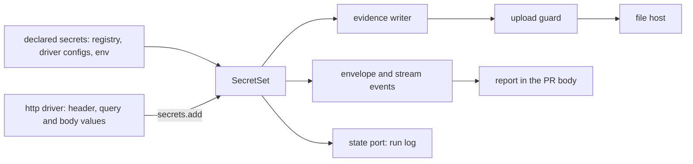

# Redaction

- **Status:** draft

A verify run writes what it sees into `.wringer/`: request headers, cookies, URLs, log lines,
database rows and screenshots. From there, step data reaches the PR description and evidence files
reach a file host behind public links. Two layers keep secrets out of all of it. Core replaces every
known secret value at each place wringer writes text. The http driver also redacts by structure:
credential headers, cookies, named query parameters and JSON body paths.

## Shape



## Threat model

- **An attacker reads** the PR description, each uploaded file through its link, the CI log of a
  public repo, and anything a run prints to stdout in CI. Each stays public for as long as its link
  or its log lives.
- **What stays local:** the `.wringer/` folder, the app's own log under the run's `children` folder,
  and the stream recordings. wringer never uploads them, and never uploads a file from outside the
  run's evidence folder.
- **Out of scope:** an attacker who can read the machine's disk, a registry written to leak on
  purpose, and a secret the app draws into its own page on a target that declares `publicData`.

## Contracts

### The secret set

A repo declares the environment variables that hold its secrets on the registry. Each driver returns
the secret values in its own config.

```ts
createWringer({ name: 'shop' })
  .secret('SHOP_API_TOKEN', 'SHOP_ADMIN_PASSWORD') // env names; each value is read when a command starts
  .target('local', shop.defineTarget({ /* …existing fields */ publicData: true }));

// a driver returns the secrets of its parsed target config, such as a queue driver's API token
export const queue = defineDriver({
  // …existing fields
  secrets: (config) => [{ name: 'queue.apiToken', value: config.apiToken }],
});
```

```ts
// core. One per process: dispatch builds it before the command opens a drive, and the supervisor
// builds its own from the same sources. The set lives in memory only and is never written to disk.
interface SecretSet {
  // Throws a `usage` WringerError for a declared value under `minimumSecretLength`. Skips a
  // collected value under it.
  readonly add: (secret: Secret) => void;

  // Every spelling of every secret, longest first, becomes `[redacted:<name>]`. Then every
  // `scheme://user:password@` becomes `scheme://[redacted]@`.
  readonly scrubText: (text: string) => string;

  // A copy with `scrubText` applied to every string and every object key, at any depth.
  readonly scrubValue: (value: unknown) => unknown;

  // The name of the first secret with any spelling in the text, or null.
  readonly findSecret: (text: string) => string | null;
}

interface Secret {
  readonly name: string; // printed in the placeholder; an env name or a driver label, never a value
  readonly value: string;
  readonly origin: 'declared' | 'collected';
}

export const minimumSecretLength = 8;
```

`dispatch` fills the set from these sources:

| Source                                                                         | Origin      |
| ------------------------------------------------------------------------------ | ----------- |
| each env name passed to `.secret()` that is set in the process env             | `declared`  |
| each `{ name, value }` that a driver's `secrets` returns for the target config | `declared`  |
| each process env and launch `env` value whose key matches `secretKeyPattern`   | `collected` |
| the password of each URL in an endpoint or a resolved driver config            | `collected` |
| each value a driver adds at runtime through `session.secrets.add`              | `collected` |

```ts
// core. Matches GITHUB_TOKEN, SHOP_DB_PASSWORD, STRIPE_API_KEY, SESSION_SECRET.
export const secretKeyPattern = /token|secret|passw|api-?key|session|auth|credential|private/iu;

// …existing fields of DriverSession
interface DriverSession<Options, TargetConfig> {
  readonly secrets: Pick<SecretSet, 'add'>;
}

// …existing fields of the driver definition
interface DriverDefinition<Options, TargetConfig> {
  readonly secrets?: (config: TargetConfig) => readonly { name: string; value: string }[];
}

// …existing fields of TargetBase
interface TargetBase<Ds extends AnyDrivers> {
  // True when every page, image and recording this target produces is fit for a public link:
  // seeded data and test accounts with no real access. Defaults to false.
  readonly publicData?: boolean | undefined;
}
```

Each secret matches in these spellings:

| Spelling                                         | Where it shows up                                 |
| ------------------------------------------------ | ------------------------------------------------- |
| the value                                        | raw text, log lines, YAML snapshots               |
| the value inside a JSON string, with its escapes | every JSON file and the envelope                  |
| `encodeURIComponent(value)`, and with `+` spaces | query strings and form bodies                     |
| base64 and base64url of the value, no padding    | a token passed on encoded                         |
| base64 of `user:password`, for a URL's password  | Basic auth, which Bun's fetch sends for URL creds |

### The evidence writer

Every evidence file goes through one writer. `openDrive`, `openRunlessDrive` and `capData` each
build it, and each passes the command's `SecretSet`.

```ts
const evidence = await session.evidence.writeFile('http', 'post.json', text);
// → { kind: 'http', path: '.wringer/runs/r_7c1/features/place-order/…-post.json',
//     sha256: '9f2c…', scrub: 'text' }
```

```ts
// core. …existing fields
interface EvidenceWriterOptions {
  readonly secrets: SecretSet; // required: no writer exists without one
}

interface EvidenceWriter {
  readonly directory: string;

  // A string, or bytes under a text extension, is decoded as UTF-8, scrubbed, then written; the
  // sha256 is of the written bytes. Bytes under an opaque extension are written as they are.
  readonly writeFile: (
    kind: string,
    name: string,
    content: string | Uint8Array,
  ) => Promise<Evidence>;

  // Records a file that a tool wrote into `directory`, such as a browser recording. Opaque
  // extensions only; the file is read once, hashed, and never rewritten.
  readonly addFile: (kind: string, path: string) => Promise<Evidence>;
}

// core. …existing fields of evidenceSchema
const evidenceSchema = z.strictObject({
  scrub: z.enum(['text', 'opaque']), // 'opaque': wringer could not scrub the file by value
});
```

The writer picks the class from the name's extension:

| Class    | Extensions                                                                  |
| -------- | --------------------------------------------------------------------------- |
| `text`   | `.json`, `.ndjson`, `.yaml`, `.yml`, `.txt`, `.log`, `.md`, `.html`, `.csv` |
| `opaque` | `.png`, `.jpg`, `.webp`, `.gif`, `.mp4`, `.webm`, `.zip`, `.har`            |

### The upload guard

The uploader in core calls this guard for every file before it sends any file. The guard owns the
refusal rules; the uploader owns the transport.

```ts
const candidate = await readUploadCandidate(evidence, { root, runID, stateDir });
const refusal = pickUploadRefusal(candidate, { publicData: target.publicData ?? false, secrets });
// → null, or { reason: 'hash-mismatch', path: '.wringer/runs/r_7c1/features/place-order/…-page.png' }
```

```ts
// core
interface UploadCandidate {
  readonly evidence: Evidence;
  readonly realPath: string; // after symlinks are resolved
  readonly evidenceFolder: string; // the run's `features` folder, resolved the same way
  readonly isRegularFile: boolean; // from lstat: a symlink is not one
  readonly sha256: string; // of the bytes read now
  readonly text: string | null; // the decoded bytes when `evidence.scrub` is 'text'
}

interface UploadRefusal {
  readonly reason:
    | 'outside-evidence-folder'
    | 'not-a-regular-file'
    | 'hash-mismatch'
    | 'opaque-on-private-target'
    | 'secret-found';
  readonly path: string;
}
```

### Structural redaction in the http driver

```ts
http({
  redact: {
    headers: ['x-shop-session'], // added to the default list, any case
    query: ['signature'], // added to the default list
    bodyPaths: ['$.customer.card', '$.items[*].coupon'], // request and response JSON
  },
});

await ctx.drivers.http.request({ method: 'POST', path: '/api/login', json, evidence: false });
// → the real response, unredacted, for the action that called it
```

```ts
// http. The default lists are in the table below.
const redactedHeaderPattern = /token|secret|api-?key|session|passw/iu; // tested on the header name

// …existing fields of httpRequestSchema
const httpRequestSchema = z.strictObject({
  evidence: z.boolean().default(true), // false: no evidence file for this request
});

// Pure. The copy of one exchange that leaves the driver: evidence, envelope data, error messages.
function buildRedactedExchange(exchange: HttpExchange, redaction: Redaction): RedactedExchange;
// → { request: { url: 'http://127.0.0.1:4100/api/orders?token=[redacted]',
//                headers: { authorization: '[redacted]' }, json: { … } },
//     response: { status: 201, headers: { 'set-cookie': 'sid=[redacted]' }, body: '…', json: { … } },
//     secrets: [{ name: 'http.header.authorization', value: 'Bearer 3f9a…' }, …] }
```

| Default list | Names                                                                                                                        |
| ------------ | ---------------------------------------------------------------------------------------------------------------------------- |
| headers      | `authorization`, `proxy-authorization`, `cookie`, `set-cookie`, `x-api-key`                                                  |
| query        | `token`, `access_token`, `id_token`, `api_key`, `apikey`, `key`, `secret`, `password`, `signature`, `sig`, `code`, `session` |

A body path is `$` followed by `.name` or `[*]` steps. A path that matches nothing changes nothing.

## Constraints

### Secret set rules

- These sinks scrub with the command's `SecretSet`: the evidence writer, the envelope's `data` and
  `error` before `capData` runs, every stream event before it reaches stdout, and every append
  through the state port, to the run log and to the late-failures file.
- The supervisor scrubs each run log event it appends, with a set built from `.secret()`, the
  process env, the launch `env` and the driver configs.
- A `launch-ready` event keeps its endpoints unscrubbed, because later commands read them back to
  build URLs. Core refuses, with a `usage` error, an endpoint that holds URL credentials or any
  spelling of a declared secret.
- A driver adds a secret it learns at runtime before it writes any evidence that holds the secret.
- A declared secret under 8 characters fails the command with a `usage` error that holds its name,
  before any driver opens. wringer never scrubs a collected value under 8 characters by value.
- The writer scrubs a file's full content in one pass, so a secret never splits across two chunks.
- The scrubber never matches a secret inside a larger base64 or hex blob, a hash, or compressed
  bytes. A base64 spelling matches only where the encoded text starts with the secret.
- `writeFile` refuses, with an `internal` error, a name whose extension is in neither list, a string
  under an opaque extension, and bytes under a text extension that are not valid UTF-8.
- `addFile` refuses a path that is not a regular file inside the writer's `directory`, and a path
  with a text extension.
- A `.har` file is scrubbed as text and recorded as `scrub: 'opaque'`, because it holds every cookie
  and header of the browser session, declared or not.
- Only the evidence writer writes into a run's `features` folder. The one exception is the tool
  whose file `addFile` then records.

### Upload rules

- The guard checks a file in this order, and refuses it at the first failure: outside the run's
  `features` folder after symlinks resolve, not a regular file, a sha256 that differs from the
  recorded one, opaque on a target without `publicData`, a text file that holds a secret
  `findSecret` finds.
- A refusal of one file fails the whole publish, with an error that holds the path and the reason.
  The publish then uploads no file.
- Publish runs the rendered report through `findSecret` before it writes the report into the PR
  description. A hit fails the publish.
- Files under `<stateDir>/payloads`, from commands with no run, never upload.

### http rules

- The http driver refuses, with a `usage` error, a request whose resolved URL has a username or a
  password, from the base URL or from a path such as `//user:pass@host/`. The refusal message holds
  the origin only.
- A redacted header's value becomes `[redacted]` in a request and in a response. Each cookie in
  `cookie` and `set-cookie` keeps its name and loses its value.
- A redacted query parameter's value becomes `[redacted]` in the evidence URL, in the access check's
  `describe` text, and in every error message. Error messages use the redacted URL, never
  `url.href`.
- Before it writes evidence, the driver adds each redacted value to `session.secrets`: the whole
  header value, the token after an auth scheme, each cookie value, each query value and each string
  at a body path.
- The `http request` command returns the redacted exchange as its data. A client call from an action
  or a check returns the real response.
- `evidence: false` writes no evidence file. The driver still adds the request's secrets to the set,
  and its errors still use the redacted URL.

## Decisions

- **Scrub by value at the sinks, on top of structure in each driver.** Four sinks cover every
  driver, every repo command and every error message, so a new driver is scrubbed without code of
  its own.
- **Refuse URL credentials in http requests.** Bun's fetch sends them as Basic auth, so stripping
  them would change what the app sees, and keeping them puts the password in every `url.href`. A
  repo sends credentials as a header built from a declared secret.
- **Opaque evidence uploads only from a target with `publicData`.** wringer cannot scrub a
  screenshot, so the target's owner states that its data is fit for public links. Every other target
  keeps its images local, and the report lists them as local files.
- **The upload guard fails closed.** One bad file stops the publish, so a partial upload never hides
  a leak.

## Builder decides

- The internal names, file layout and helper functions of both layers.
- How the scrubber builds its matcher, as long as a longer secret wins over a shorter one.
- The wording of each error message and hint.
- How the report lists an opaque file that stays local.

## Out of scope

- The uploader's transport, the file host's API and the link expiry. The publish design owns them.
- Scrubbing the app's own log under the run's `children` folder. Step data read from it is scrubbed
  at the envelope.

## Open questions

- **Does the shop example's `local` target set `publicData`?** The owner settles it. Until then,
  `local` sets it, because it runs on seeded data, and `demo` does not.

## Work items

### Scrub every known secret at core's sinks

**Outcome:** a secret that the registry, a driver config or the environment declares never appears
in evidence, step data, an error message, the run log or an upload, from any driver.

**Design:** [The secret set](#the-secret-set), [The evidence writer](#the-evidence-writer),
[The upload guard](#the-upload-guard), [Secret set rules](#secret-set-rules) and
[Upload rules](#upload-rules).

**First step:** reproduce the leak. Set `SHOP_API_TOKEN=planted-shop-token` in the env, run
`bun verify up` and `bun verify doctor`, then run
`bun verify http request --path /api/orders --header "authorization: Bearer planted-shop-token"`.
Run `grep -r planted-shop-token .wringer/` and keep the hits as the baseline.

**Acceptance:**

- [ ] With the shop registry declaring `.secret('SHOP_API_TOKEN')`, no file under `.wringer/` holds
      the planted secret after the reproduction above. Evidence: a `dispatch` test that greps the
      state folder.
- [ ] Each spelling in the spellings table becomes `[redacted:<name>]`, the longer secret wins an
      overlap, object keys are scrubbed, and a declared secret of 7 characters throws `usage`.
      Evidence: `test.each` rows in the `createSecretSet` tests.
- [ ] A repo command that returns, throws and emits a planted secret produces an envelope, a stream
      event, a run log line and an over-cap `payload.json` without it. Evidence: the `dispatch`
      tests.
- [ ] A `crashed` event whose reason holds a launch env secret is scrubbed. Evidence: the
      `runSupervisor` tests.
- [ ] `writeFile` scrubs a string and text bytes before it hashes them, writes PNG bytes as they
      are, and refuses an unknown extension. `addFile` refuses a symlink and a path outside its
      folder. Evidence: the `createEvidenceWriter` tests.
- [ ] An endpoint with URL credentials is refused. Evidence: the `startRun` tests.
- [ ] The guard refuses each reason in the upload rules, in order, and passes a clean file.
      Evidence: `test.each` rows in the `pickUploadRefusal` tests, and `readUploadCandidate` tests
      with a symlink and with a file changed after it was recorded.
- [ ] The `place-order` journey still passes with the planted secret set. Evidence: the
      `place-order` feature's journey in `bun verify`, with its verdict.

### Redact http exchanges by structure

**Outcome:** the http driver redacts credential headers, cookies, named query parameters and JSON
body paths in its evidence, its command data and its errors, refuses URL credentials, and adds every
value it redacts to core's secret set.

**Depends on:**
[Scrub every known secret at core's sinks](#scrub-every-known-secret-at-cores-sinks), for
`session.secrets`.

**Design:** [Structural redaction in the http driver](#structural-redaction-in-the-http-driver) and
[http rules](#http-rules).

**First step:** reproduce the leak with no secret declared. Run `bun verify up` and
`bun verify doctor`, then run
`bun verify http request --path "/api/orders?token=planted-q-55e1" --header "cookie: sid=planted-c-91b4"`.
Run `grep -r planted- .wringer/` and keep the hits as the baseline.

**Acceptance:**

- [ ] After the reproduction above, neither planted value appears under `.wringer/` or in the
      command's stdout. Evidence: an `http` driver test that greps the evidence folder and the
      envelope.
- [ ] Each default header, a header whose name matches the pattern, a configured header, each
      `set-cookie`, and each default and configured query parameter are redacted in request and
      response. Evidence: `test.each` rows in the `buildRedactedExchange` tests.
- [ ] `$.a.b` and `$.items[*].token` redact in request and response JSON, and an unmatched path
      changes nothing. Evidence: the `buildRedactedExchange` tests.
- [ ] A base URL with credentials and a `//user:pass@host/` path are refused, and the message holds
      no password. Evidence: the `buildRequestPlan` tests.
- [ ] A transport failure on a URL with a redacted query gives an error without the value. Evidence:
      the `http` driver tests.
- [ ] An Authorization token that an action passes on into a repo command's data is scrubbed there.
      Evidence: the `http` driver tests, through `session.secrets`.
- [ ] `evidence: false` writes no file, and an action still gets the real response. Evidence: the
      `http` driver tests.
- [ ] The `place-order` journey still passes. Evidence: the `place-order` feature's journey in
      `bun verify`, with its verdict.
