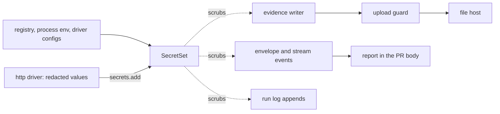

# Redaction

- **Status:** draft

A verify run writes what it sees into `.wringer/`: request headers, cookies, URLs, log lines,
database rows and screenshots. From there, step data reaches the PR description and evidence files
reach a file host behind public links. Two layers keep secrets out of all of it. Core replaces every
known secret value at each place wringer writes text. The http driver also redacts by structure:
credential headers, cookies, named query parameters and JSON body paths.

## Shape



## Threat model

- **An attacker reads** the PR description, each uploaded file through its link, the CI log of a
  public repo, and anything a run prints to stdout in CI. Each stays public for as long as its link
  or its log lives.
- **What stays local:** the `.wringer/` folder, including the app's own log under the run's
  `children` folder, `supervisor.log` and the stream recordings. wringer never uploads a file from
  outside a run's `features` folder.
- **Out of scope:** an attacker who can read the machine's disk, a registry written to leak on
  purpose, and a secret the app draws into its own page on a target whose evidence uploads.

## Contracts

### The secret set

A repo declares the environment variables that hold its secrets on the registry. A driver returns
the secret values of its own config.

```ts
createWringer({ name: 'shop' }).secret('SHOP_API_TOKEN', 'SHOP_ADMIN_PASSWORD'); // env names; each value is read when a command starts

// a driver returns the secrets of its parsed target config, such as a queue driver's API token
export const queue = defineDriver({
  // …existing fields
  secrets: (config) => [{ name: 'queue.apiToken', value: config.apiToken }],
});
```

```ts
// core. One per process. Collected values also persist in the run's secrets file.
interface SecretSet {
  // Throws a `usage` WringerError for a declared value under `minimumSecretLength`. A collected
  // value of 4 to 7 characters matches only as a whole token, with no ASCII letter or digit on
  // either side (`_`, `-` and punctuation count as edges); one under 4, or empty, is skipped.
  readonly add: (secret: Secret) => void;

  // Every spelling of every secret, longest first, anywhere in the text, becomes
  // `[redacted:<name>]`. Then every `scheme://user:password@` becomes
  // `scheme://[redacted:url-credentials]@`.
  readonly scrubText: (text: string) => string;

  // A copy with `scrubText` applied to every string and every object key, at any depth. When two
  // scrubbed keys collide, the later one gets a `#2`, `#3` suffix, so no value is lost.
  readonly scrubValue: (value: unknown) => unknown;

  // The name of the first secret with any spelling in the text, or null. With `origin`, only a
  // secret of that origin counts.
  readonly findSecret: (text: string, origin?: Secret['origin']) => string | null;
}

interface Secret {
  readonly name: string; // printed in the placeholder; never a value
  readonly value: string;
  readonly origin: 'declared' | 'collected';
}

const minimumSecretLength = 8;
export const minimumTokenLength = 4; // a collected value this long or longer, up to 7, is a token

// …existing fields of DriverSession. Core stamps `origin: 'collected'` on each add.
interface DriverSession<Options, TargetConfig> {
  readonly secrets: { readonly add: (secret: { name: string; value: string }) => void };
}

// …existing fields of the driver definition
interface DriverDefinition<Options, TargetConfig> {
  readonly secrets?: (config: TargetConfig) => readonly { name: string; value: string }[];
}

// core. Matches GITHUB_TOKEN, SHOP_DB_PASSWORD, STRIPE_API_KEY and SESSION_SECRET; misses
// SSH_AUTH_SOCK and SESSION_TIMEOUT.
export const secretKeyPattern = /token|secret|passw|api[-_]?key|credential|private[-_]?key/iu;
```

Each process fills its set from these sources, in this order:

| Source                                                                         | Origin      | Placeholder name  | Dispatch | Supervisor |
| ------------------------------------------------------------------------------ | ----------- | ----------------- | -------- | ---------- |
| each env name passed to `.secret()` with a value in the process env            | `declared`  | the env name      | yes      | yes        |
| each process env value whose key matches `secretKeyPattern`                    | `collected` | the env name      | yes      | yes        |
| each launch `env` value whose key matches `secretKeyPattern`                   | `collected` | the env name      | no       | yes        |
| each `{ name, value }` that a driver's `secrets` returns for the target config | `declared`  | the name it gives | yes      | no         |
| the password of each URL in a resolved driver config                           | `collected` | `<driver>.url`    | yes      | no         |
| each value a driver adds at runtime through `session.secrets.add`              | `collected` | the name it gives | yes      | no         |
| each entry of the run's secrets file                                           | `collected` | as stored         | yes      | yes        |

Each secret matches in these spellings:

| Spelling                                                                               | Where it shows up                                              |
| -------------------------------------------------------------------------------------- | -------------------------------------------------------------- |
| the value                                                                              | raw text, log lines, YAML snapshots                            |
| the value inside a JSON string, with its escapes                                       | every JSON file and the envelope                               |
| `encodeURIComponent(value)`, with `+` for spaces, and as `URLSearchParams` encodes it  | query strings and form bodies                                  |
| base64 and base64url of the value, cut to its first `floor(length / 3) * 4` characters | a token passed on encoded, with or without more bytes after it |
| base64 of `user:password`, for a URL's password                                        | Basic auth, which Bun's fetch sends for URL creds              |

### The evidence writer

Every evidence file goes through one writer. `openDrive`, `openRunlessDrive` and `capData` each
build it, and each passes the command's `SecretSet`.

```ts
const evidence = await session.evidence.writeFile('http', 'post.json', text);
// → { kind: 'http', path: '.wringer/runs/r_7c1/features/place-order/…-post.json',
//     sha256: '9f2c…', scrub: 'text' }
```

```ts
// core. …existing fields
interface EvidenceWriterOptions {
  readonly secrets: SecretSet; // required: no writer exists without one
}

interface EvidenceWriter {
  readonly directory: string;

  // The sha256 is always of the bytes written. The class table below holds what is scrubbed.
  readonly writeFile: (
    kind: string,
    name: string,
    content: string | Uint8Array,
  ) => Promise<Evidence>;

  // Records a file that a tool wrote into `directory`, such as a browser recording. The file is
  // read once, hashed, and never rewritten.
  readonly addFile: (kind: string, path: string) => Promise<Evidence>;
}

// core. …existing fields of evidenceSchema. Optional, so stored runs and verdicts still parse.
const evidenceSchema = z.strictObject({
  scrub: z.enum(['text', 'opaque']).optional(), // absent reads as 'opaque'
});
```

| Content given to the writer                         | Scrubbed | Recorded `scrub` |
| --------------------------------------------------- | -------- | ---------------- |
| a string, under any name but an image or video name | yes      | `text`           |
| a string named `.har`                               | yes      | `opaque`         |
| bytes named `.json`, `.yaml`, `.txt`, `.log`, `.md` | yes      | `text`           |
| bytes under any other name                          | no       | `opaque`         |
| a file through `addFile`                            | no       | `opaque`         |

A `.har` file is scrubbed but recorded as `opaque`, because it holds every cookie and header of the
browser session, declared or not.

### The upload guard

Every upload path calls the guard for each file before it sends any file: `report`'s link step, and
the publish command of [the PR report design](pr-report.md). The guard owns the refusal rules, and
the uploader owns the transport.

```ts
const candidate = await readUploadCandidate(evidence, { root, stateDir, files });
const refusal = pickUploadRefusal(candidate, { targetUploads, secrets });
// → null, or { reason: 'hash-mismatch', path: '.wringer/runs/r_7c1/features/place-order/…-page.png' }
```

```ts
// core
interface UploadCandidate {
  readonly evidence: Evidence;
  readonly exists: boolean;
  readonly realPath: string; // after symlinks are resolved
  readonly isInFeaturesFolder: boolean; // realPath sits in `<stateDir>/runs/<runID>/features/`
  readonly isRegularFile: boolean; // from lstat: a symlink is not one
  readonly sha256: string | null; // of the bytes read now
  readonly text: string | null; // the decoded bytes when `evidence.scrub` is 'text'
}

interface UploadRefusal {
  readonly reason:
    | 'missing'
    | 'outside-features-folder'
    | 'not-a-regular-file'
    | 'hash-mismatch'
    | 'opaque-on-local-target'
    | 'secret-found';
  readonly path: string;
}

// `targetUploads` is true only when the verdict's target sets `evidence: 'upload'`, the field the PR
// report design owns. A caller that cannot tell the verdict's target passes false.
```

### Structural redaction in the http driver

```ts
http({
  redact: {
    headers: ['x-shop-session'], // added to the default list, any case
    query: ['signature'], // added to the default list
    bodyPaths: ['$.customer.card', '$.items[*].coupon'], // request and response JSON
  },
});

await ctx.drivers.http.request({ method: 'POST', path: '/api/login', json, evidence: false });
// → the real response, unredacted, for the action that called it
```

```ts
// http. Tested on the header name, on top of the default list below.
const redactedHeaderPattern = /token|secret|api-?key|session|passw/iu;

// …existing fields of httpRequestSchema
const httpRequestSchema = z.strictObject({
  evidence: z.boolean().default(true), // false: no evidence file for this request
});

// Pure. The copy of one exchange that leaves the driver: evidence, envelope data, error messages.
function buildRedactedExchange(exchange: HttpExchange, redaction: Redaction): RedactedExchange;
// → { request: { url: 'http://127.0.0.1:4100/api/orders?token=[redacted:http.query.token]',
//                headers: { authorization: '[redacted:http.header.authorization]' }, json: { … } },
//     response: { status: 201, headers: { 'set-cookie': 'sid=[redacted:http.cookie.sid]' }, … },
//     secrets: [{ name: 'http.header.authorization', value: 'Bearer 3f9a…' }, …] }
```

| Default list | Names                                                                                                |
| ------------ | ---------------------------------------------------------------------------------------------------- |
| headers      | `authorization`, `proxy-authorization`, `cookie`, `set-cookie`, `x-api-key`                          |
| query        | `token`, `access_token`, `id_token`, `api_key`, `apikey`, `key`, `secret`, `password`, `sig`, `code` |

A body path is `$` followed by `.name` or `[*]` steps, and its placeholder name is `http.body`. A
path that matches nothing changes nothing. When a body path matches the response JSON, the driver
rebuilds the response `body` string as compact JSON from the redacted `json`. When none matches, the
`body` stays as received.

## Constraints

### Secret set rules

- Dispatch adds the registry and process env sources first, so they scrub an error thrown while it
  builds driver configs.
- These sinks scrub with the command's set, as it stands when they write: the evidence writer, the
  whole envelope before `capData` runs, every stream event before it reaches stdout, and every
  append through the state port, to the run log and to the late-failures file.
- The supervisor scrubs each run log event it appends with its own set, and reloads the run's
  secrets file before each append.
- The run's secrets file is `secrets.ndjson` in the run directory, outside `features`, created with
  mode 0600. Each process appends every collected secret it adds, as `{ name, value }`, under the
  run's lock: dispatch its runtime adds, the supervisor its launch `env` values.
- Every command of a run, `report` and the publish command load the secrets file of each run they
  read. A run whose file is gone was scrubbed when each command wrote, so its log stays clean.
- The secrets file never enters evidence, a report or an upload. Core removes it once the run's
  target no longer points at the run: at `down` and `detach`, and when `up` or `attach` replaces the
  run, as `--restart` does.
- A collected value of 4 to 7 characters matches only where no letter or digit sits on either side.
- Core refuses an endpoint that holds URL credentials or any spelling of a declared secret, at
  `launch-ready` and at attach. The supervisor ends the run with a `usage` message as the crash
  reason, so `up` and `attach` answer `environment`. A `launch-ready` event keeps its endpoints
  unscrubbed, for later commands to read back.
- `up` and `attach` refuse with `usage`, before any run event, a registry whose feature name holds a
  spelling of any secret in the command's set, because a `scopes-read` event keeps its feature names
  unscrubbed for `done` to match.
- The doctor's `revision` check fails with `usage` on a revision that holds a spelling of any secret
  in the command's set, and the doctor then writes no `revision-read`, because that event keeps its
  revision unscrubbed for `done` to compare. A failure message gives a bad revision's type or
  length, and never the value.
- An env value that is all digits, or a URL with no password, is never collected.
- A collected value under 4 characters is never scrubbed by value, so a copy outside its redacted
  field stays. Such a value has at most 62³ spellings and protects nothing, and scrubbing it would
  wreck the evidence.
- A driver adds a secret it learns at runtime before it writes any evidence that holds the secret.
- The envelope is scrubbed after its `data` passes the command's schema, so a placeholder never
  fails that check.
- The writer scrubs a file's full content in one pass, so a secret never splits across two chunks.
- The scrubber misses a secret inside a larger base64 or hex blob at an offset that is not a whole
  group, inside a hash, and inside compressed bytes.
- `writeFile` refuses, with an `internal` error, a string named as an image or a video, and bytes
  under a text name that are not valid UTF-8.
- `addFile` refuses a path that is not a regular file inside the writer's `directory`.

### Upload rules

- The guard checks a file in the order of `UploadRefusal.reason`, and returns the first that fails.
- The report planner never offers an opaque file from a target without `evidence: 'upload'`, so the
  report shows it as local. The guard's `opaque-on-local-target` refusal is the fail-closed backstop
  for a planner bug, and it too keeps the file local.
- Any refusal but `secret-found` keeps that one file local: it gets no `url`. A `secret-found`
  refusal fails the command with an `internal` error before any file is sent, because the scrubber
  missed a secret that step data may hold too.
- At upload time, the set holds the registry and process env sources and the secrets file of each
  run the verdicts name. It builds no driver config.
- The publish command runs the rendered report through `findSecret` before it writes the PR
  description. A hit fails the publish.

### http rules

- The http driver refuses, with a `usage` error, a request whose resolved URL has a username or a
  password, from the base URL or from a path such as `//user:pass@host/`. The refusal message holds
  the origin only.
- Each cookie in `cookie` and `set-cookie` keeps its name and loses its value.
- A redacted query value is replaced in the evidence URL, in the access check's `describe` text, and
  in every error message. Error messages use the redacted URL, never `url.href`.
- The driver redacts the query of a `location` or `referer` header with the same parameter list,
  because a redirect carries an OAuth `code`.
- Before it writes evidence, the driver adds these values to `session.secrets`:
  - the whole value of each redacted header;
  - the token after the auth scheme, for `authorization` and `proxy-authorization`;
  - each cookie value, and its unquoted form when it is quoted;
  - the decoded and the raw value of each redacted query parameter;
  - each string under a body path, at any depth.
- The `http request` command returns the redacted response, `{ status, headers, body, json }`, as
  its data. A client call from an action or a check returns the real response.
- `evidence: false` writes no evidence file. The driver still adds the request's secrets to the set,
  and its errors still use the redacted URL.

## Decisions

- **Scrub by value at the sinks, on top of structure in each driver.** Four sinks cover every
  driver, repo command and error message, with no code in a new driver.
- **Refuse URL credentials in http requests and endpoints.** Bun's fetch sends them as Basic auth,
  so stripping them changes what the app sees, and keeping them puts the password in every
  `url.href`. A repo sends credentials as a header built from a declared secret.
- **Opaque evidence uploads only from a target with `evidence: 'upload'`.** wringer cannot scrub a
  screenshot, so setting that field states that the target's pages hold no real secrets: seeded data
  and test accounts with no real access.

## Builder decides

- The internal names, file layout and helper functions of both layers.
- How the scrubber builds its matcher, as long as a longer secret wins over a shorter one.
- The wording of each error message and hint.

## Work items

### Scrub every known secret at core's sinks

**Outcome:** a secret that the registry, a driver config or the environment declares never appears
in evidence, step data, an error message, the run log or an upload, from any driver.

**Design:** [The secret set](#the-secret-set), [The evidence writer](#the-evidence-writer),
[The upload guard](#the-upload-guard), [Secret set rules](#secret-set-rules) and
[Upload rules](#upload-rules).

**First step:** reproduce the leak. Set `SHOP_API_TOKEN=planted-shop-token` in the env, run
`bun verify up` and `bun verify doctor`, then run
`bun verify http request --path /api/orders --header "authorization: Bearer planted-shop-token"`.
Run `grep -r planted-shop-token .wringer/` and keep the hits as the baseline.

**Scope note:** the guard goes into `report`'s link step, which cannot tell a verdict's target yet,
so it passes `targetUploads: false` and every opaque file stays local there, screenshots included.
`publish` passes the real value: it is true for a journey whose target uploads.

**Acceptance:**

- [ ] With the shop registry declaring `.secret('SHOP_API_TOKEN')`, after the reproduction above, no
      file under the run's `features` folder, the run log or `payloads` holds the planted secret.
      Evidence: a `dispatch` test that greps those paths.
- [ ] Each spelling in the spellings table becomes `[redacted:<name>]`, the longer secret wins an
      overlap, colliding keys keep both values, and a declared secret of 7 characters throws
      `usage`. Evidence: `test.each` rows in the `createSecretSet` tests.
- [ ] `SSH_AUTH_SOCK` and `SESSION_TIMEOUT=3600` are not collected, and `GITHUB_TOKEN` is. Evidence:
      the `createSecretSet` tests.
- [ ] A repo command that returns, throws and emits a planted secret produces an envelope, a stream
      event, a run log line and an over-cap `payload.json` without it. Evidence: the `dispatch`
      tests.
- [ ] A `crashed` event whose reason holds a launch env secret is scrubbed, and an endpoint with URL
      credentials is refused. Evidence: the `runSupervisor` and `startRun` tests.
- [ ] A token the http driver collects from a login response, which the app then logs, never shows
      in a later `stream read` or in the PR body from publish, each run in its own process; `down`
      removes the secrets file, created with mode 0600. Evidence: the `dispatch` tests.
- [ ] A collected 6-digit session id echoed in a response message is scrubbed, and the same digits
      inside a longer number are not. Evidence: `test.each` rows in the `createSecretSet` tests.
- [ ] Each row of the class table writes and records as the table holds, and the sha256 is of the
      scrubbed bytes. `addFile` refuses a symlink and a path outside its folder. Evidence: the
      `createEvidenceWriter` tests.
- [ ] The guard returns each reason, in order, and null for a clean file. Evidence: `test.each` rows
      in the `pickUploadRefusal` tests, and `readUploadCandidate` tests with a symlink, a missing
      file and a file changed after it was recorded.
- [ ] `report` with an upload hook never passes a refused file to the hook. Evidence: the
      `build-verdict-commands` tests.
- [ ] The `place-order` journey still passes with the planted secret set. Evidence: the
      `place-order` feature's journey in `bun verify`, with its verdict.

### Redact http exchanges by structure

**Outcome:** the http driver redacts credential headers, cookies, named query parameters and JSON
body paths in its evidence, its command data and its errors, refuses URL credentials, and adds every
value it redacts to core's secret set.

**Depends on:**
[Scrub every known secret at core's sinks](#scrub-every-known-secret-at-cores-sinks), for
`session.secrets`.

**Design:** [Structural redaction in the http driver](#structural-redaction-in-the-http-driver) and
[http rules](#http-rules).

**First step:** reproduce the leak with no secret declared. Run `bun verify up` and
`bun verify doctor`, then run
`bun verify http request --path "/api/orders?token=planted-query-token" --header "cookie: sid=planted-cookie-token"`.
Run `grep -r planted- .wringer/` and keep the hits as the baseline.

**Acceptance:**

- [ ] After the reproduction above, neither planted value appears in the run's `features` folder,
      the run log or the command's stdout. Evidence: an `http` driver test that greps those and the
      envelope.
- [ ] Each default header, a header whose name matches the pattern, a configured header, each
      `set-cookie`, and each default and configured query parameter are redacted in request and
      response. Evidence: `test.each` rows in the `buildRedactedExchange` tests.
- [ ] `$.a.b` and `$.items[*].token` redact in request and response JSON, and an unmatched path
      changes nothing. Evidence: the `buildRedactedExchange` tests.
- [ ] A base URL with credentials and a `//user:pass@host/` path are refused, and the message holds
      no password. Evidence: the `buildRequestPlan` tests.
- [ ] A transport failure on a URL with a redacted query gives an error without the value. Evidence:
      the `http` driver tests.
- [ ] An Authorization token that an action passes on into a repo command's data is scrubbed there.
      Evidence: the `http` driver tests, through `session.secrets`.
- [ ] `evidence: false` writes no file, and an action still gets the real response. Evidence: the
      `http` driver tests.
- [ ] The `place-order` journey still passes. Evidence: the `place-order` feature's journey in
      `bun verify`, with its verdict.
