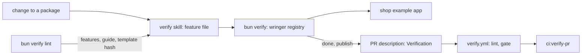

# Self-verify

- **Status:** draft

wringer checks its own changes with its own verify CLI. The root `bun verify` runs a wringer
registry whose features are wringer's packages, each driven through the real CLI against the shop
example app, and every pull request carries a report that a CI gate checks. The verify skill, its
per-feature files, the guide and the template version all come from the registry or the installed
package, so lint catches every drift between them.

Work items marked **[VS]** depend on [verdict-scope.md](./verdict-scope.md), which owns the report
format, the verdict and the gate rules. Work items marked **[PR]** depend on
[pr-report.md](./pr-report.md), which owns `publish`, the report markers and the uploader.

## Shape



## Contracts

### The wringer registry

```ts
// shop-example module. Both registries start from one base, so a target, action, command or
// doctor check is defined once.
export function buildShopBase(name: string): WringerBuilder<ShopDrivers>;
// → the `local` and `demo` targets, the five drivers, `action place-order`,
//   `orders count` and the `orders-api` check; no features, no ignore list

export function createShopRegistry(options?: ShopRegistryOptions): Wringer;
// buildShopBase('shop'), then the shop's four features and its ignore list

export function createWringerRegistry(options?: ShopRegistryOptions): Wringer;
// buildShopBase('wringer'), then the features below, `.shared(...)` [VS] and `.ignore(...)`
```

The root `verify` script runs `createWringerRegistry` with the skill folder `.claude/skills/verify`.
A `verify:shop` script runs `createShopRegistry` with the skill folder
`packages/shop-example/verify-skill`.

| Feature           | Paths                                                                                 |
| ----------------- | ------------------------------------------------------------------------------------- |
| `browser-driver`  | `packages/browser/package.json`, `packages/browser/src/**`                            |
| `http-driver`     | `packages/http/package.json`, `packages/http/src/**`                                  |
| `db-driver`       | `packages/db/package.json`, `packages/db/src/**`                                      |
| `stream-driver`   | `packages/stream/package.json`, `packages/stream/src/**`                              |
| `terminal-driver` | `packages/terminal/package.json`, `packages/terminal/{ghostty,scripts,src}/**`        |
| `mcp-driver`      | `packages/mcp/package.json`, `packages/mcp/src/**`                                    |
| `core`            | `packages/core/{package.json,envelope.schema.json}`, `packages/core/{src,scripts}/**` |
| `cli`             | `packages/gunshi/package.json`, `packages/gunshi/src/**`                              |
| `guide`           | `packages/gunshi/guide/**`                                                            |

`cli` lists `features`, and `guide` lists `guide`, in their `commands`, so each journey's own
commands are its drives, as [verdict-scope.md](./verdict-scope.md) defines.

```ts
// createWringerRegistry
.shared('bun.lock', 'package.json', '.bun-version', 'bunfig.toml', 'packages/shop-example/**')
.ignore(
  '*.md', 'docs/**', '.claude/**', '.github/**', '.lefthook/**', 'scripts/**',
  '**/*.test.ts', '**/test-utils/**', '**/e2e/**',
  'packages/*/README.md', 'packages/*/CHANGELOG.md', 'packages/*/LICENSE', 'packages/*/tsconfig*.json',
  // …each root config file that no runtime reads, such as `.oxlintrc.json` and `knip.json`
)
```

### The `features` command

```ts
// bun verify features
// → data: {
//     features: [{ name: 'http-driver', summary: 'Send HTTP requests to the app and read the answers',
//                  paths: ['packages/http/package.json', 'packages/http/src/**'],
//                  file: 'references/feature-http-driver.md' }],
//     shared: ['bun.lock', …], ignore: ['*.md', …] }
// bun verify features --markdown
// → data.markdown: the feature table that SKILL.md holds; --human prints it raw

// core module, the existing `features` built-in, now with `file`, `shared`, `ignore` and
// `--markdown` (it dropped `current`; `status` still names the current feature):
// needsRun false, needsDoctor false, effect 'read'
const featuresDataSchema = z.strictObject({
  features: z.array(
    z.strictObject({
      name: z.string(),
      summary: z.string(),
      paths: z.array(z.string()),
      file: z.string(), // `references/feature-<name>.md`, relative to the skill folder
    }),
  ),
  shared: z.array(z.string()),
  ignore: z.array(z.string()),
  markdown: z.string().optional(), // only with --markdown
});
```

The table has the columns Feature, Summary and File, in registry order, with each File cell a
relative link. `lint` compares the span with it cell by cell, so the column padding that a Markdown
formatter adds does not fail it. It sits in SKILL.md between `<!-- wringer:features -->` and
`<!-- /wringer:features -->`.

### The verify skill shape

```text
<skill folder>/
  SKILL.md                      # frontmatter, the check-a-change steps, the feature table span
  references/feature-<name>.md  # one per registered feature
```

````markdown
# http-driver

## Journey

```bash
bun verify use --feature http-driver
bun verify http request --path /api/orders
```

## End state

- The second `http request` returns a `data.json` list one entry longer than the first.
````

### Lint

```ts
// gunshi module
export const lintFailureSchema = z.strictObject({
  check: z.enum([
    'paths', // a feature, shared or ignore glob that matches no file
    'unclaimed', // a listed file that no feature, shared or ignore glob matches
    'registry', // the registry file sits under no shared glob and no feature's paths
    'journey', // a CLI line in the skill's code blocks that would fail to parse
    'feature-file', // a missing, orphaned or misshapen feature file
    'feature-table', // the SKILL.md span differs from `features --markdown`
    'template', // missing frontmatter, or a template hash that differs from the installed one
  ]),
  where: z.string(), // `feature http-driver`, `ignore`, `shared`, `<path>` or `<path>:<line>`
  problem: z.string(),
});
```

### The guide

```ts
// bun verify guide
// → data: { version: '0.3.0', topics: [{ name: 'create', summary: 'Add a verify CLI to a repo' }, …] }
// bun verify guide create
// → data: { version: '0.3.0', topic: 'create', text: '# Create a verify CLI\n…' }; --human prints text
// bun verify guide nope
// → error.code 'usage', hint lists the topics
// bun verify guide template
// → data.text names the absolute path of the installed template folder, to copy from

// bunx wringer-gunshi guide [topic]: the same output, for a repo that has no verify CLI yet
```

The guide lives in `packages/gunshi/guide/`: one Markdown file per topic, its first line `# <title>`
and its second paragraph the summary, plus `template/`.

### The template hash

```ts
// gunshi module; replaces the integer `templateVersion`
export function readTemplateHash(): Promise<string>;
// → 'sha256:3f9a0c2b71de', which a repo's verify SKILL.md records in its frontmatter as
//   `metadata.wringer-template: 'sha256:3f9a0c2b71de'`
```

### The PR check script

```ts
// bun run --silent ci:verify-pr       (local: the PR of the current branch)
// PR_NUMBER=142 bun run --silent ci:verify-pr   (CI)
// stdout, one JSON object:
// → { ok: false, pr: 142, checks: [
//     { name: 'pull-request', ok: true,  detail: '#142 into main' },
//     { name: 'report-block', ok: true,  detail: 'one report block under ## Verification' },
//     { name: 'registry',     ok: false, detail: 'the report is from shop; this CLI is wringer' },
//     { name: 'gate',         ok: false, detail: 'skipped: an earlier check failed' } ] }

const prCheckSchema = z.strictObject({
  ok: z.boolean(), // true only when every check is ok
  pr: z.number().int().positive().nullable(), // null when no PR was found
  checks: z.array(
    z.strictObject({
      name: z.enum(['pull-request', 'report-block', 'registry', 'gate']),
      ok: z.boolean(),
      detail: z.string(),
    }),
  ),
});
```

### The verify workflow

```yaml
# .github/workflows/verify.yml; a local workflow, beside the synced pr.yml
on:
  pull_request:
    types: [opened, synchronize, reopened, edited] # `edited`: a publish rewrites the description
permissions:
  contents: read
  pull-requests: read
concurrency:
  group: ${{ github.workflow }}-${{ github.ref }}
  cancel-in-progress: true
jobs:
  lint: # timeout-minutes: 5; runs `bun verify lint`
  gate: # timeout-minutes: 5; checks out the PR head with fetch-depth 0, filter blob:none,
    # persist-credentials false; env PR_NUMBER and GH_TOKEN (the workflow token);
    # runs `bun run --silent ci:verify-pr`
```

## Constraints

- Every file that `git ls-files` lists matches a feature glob, a shared glob or an ignore glob in
  the wringer registry; `lint` fails on each one that does not.
- A change limited to tests, test utils, docs, `.claude/` or `scripts/` leaves every verdict fresh.
- The `local` target of the wringer registry uploads its evidence through the core uploader [PR].
  The `local` target of the shop registry keeps its evidence local.
- The wringer registry reads the upload URL and token from `VERIFY_UPLOAD_URL` and
  `VERIFY_UPLOAD_TOKEN`, only when `publish` uploads. A command that never uploads, such as `report`
  or `publish --dry-run`, needs neither.
- `lint` fails when a feature has no `references/feature-<name>.md`, and when a
  `references/feature-*.md` matches no registered feature.
- `lint` fails when a feature file lacks `## Journey` or `## End state`, or when the first line of
  its first `bash` block under Journey is not `<wringer-command> use --feature <name>`.
- `lint` fails when the SKILL.md span is missing or differs from `features --markdown`. The hint
  says to replace the span with that output.
- `lint` reads only the git listing and the skill folder, and starts no run.
- The shop registry claims every file of the repo too, so its ignore list names each folder and root
  file outside the shop example, and its `lint` passes over the whole tree.
- The template hash covers each file under `guide/template/` except tests, in sorted path order, as
  the SHA-256 of each path, a NUL byte, its bytes and a NUL byte; the hash keeps its first 12 hex
  digits.
- The hash reads the `wringer-template` line of the template's `SKILL.md` with its value left out,
  so the skill can record its own hash. A test fails until that line holds the current hash.
- `lint` fails with check `template` when `wringer-template` is a number or a hash other than the
  installed one. The hint gives `bun verify guide template` and the new hash.
- `guide` reads only files inside the installed `@wringer/gunshi` package.
- The `skill install` command and the installable `wringer` skill no longer exist.
- The verify workflow holds no secret, and its token has only `contents: read` and
  `pull-requests: read`, so a fork's PR runs it the same way.
- No `run:` step in the verify workflow holds `${{ }}`. The PR number and token reach the script
  through `env:`.
- The PR check script reads the description with `gh pr view`, never from the event payload, so a
  rerun reads the current text.
- The PR check script runs the checks in order and skips each check after the first failure.
- The PR check script exits 0 when `ok` is true, 1 when a check fails, and 2 when it cannot run,
  such as when `gh` is missing or the base ref is not fetched.
- Neither job has an `if:` or a path filter.
- `pr.yml` stays as repo-sync delivers it.

## Decisions

- **The guide ships in `@wringer/gunshi` and the CLI serves it.** The text an agent reads always
  matches the installed version, and no copy goes stale in a repo.
- **A content hash replaces the hand-bumped template version.** A template edit always changes the
  hash, so no release forgets to ask repos to upgrade.
- **The wringer registry lives in the shop example package.** It needs the shop's targets, action
  and check, and the package is private and shared by every journey.
- **The shop's verify skill moves to `packages/shop-example/verify-skill/`.** It stays the worked
  example of the template and the fixture of the shop lint test, and agents in this repo load only
  the wringer skill.
- **One script is both the acceptance check and the CI gate step.** The check that proves the job
  done is the check CI keeps running after it.
- **The driver features cover a whole package each, and `core` stays one feature.** Its source sits
  in one flat folder, so a glob split by file name would break on each new file.

## Builder decides

- Internal names, file layout and test layout.
- The wording of each lint problem, hint and guide summary.
- The exact list of root config files in the ignore list, within the `unclaimed` rule.
- The journey and end state in each feature file.
- How `features --markdown` escapes a pipe in a summary.

## Out of scope

- The report format, the verdict and the gate rules: [verdict-scope.md](./verdict-scope.md).
- `publish`, the report markers and the uploader: [pr-report.md](./pr-report.md).
- Generating feature files. Each one is hand-written; lint checks it.

## Open questions

- **Does `core` split into runs and verdicts, report, and supervisor?** The owner settles it, once
  the supervisor and report files move into their own folders. Until then `core` is one feature.
- **Is `verify / gate` a required check?** The owner sets it in the `main` ruleset, after the last
  work item merges. Until then it runs and reports without blocking a merge.

## Work items

### 1. Check that a PR carries a passing wringer report

**Outcome:** `bun run --silent ci:verify-pr` prints the JSON object in
[The PR check script](#the-pr-check-script) and exits 0 only when the PR description holds one
report block that wringer's CLI published and `gate` passes on it. It stays out of CI, and fails
until the other work items land.

**Depends on:** none. Its `report-block` check reads the markers of [PR], and its `registry` check
reads the registry name of the report [VS]; until those land, both checks fail.

- [ ] With no PR for the branch, it prints `pr: null` and exits 2. Evidence: a test.
- [ ] A description with no report block fails `report-block` and skips the rest. Evidence: a test.
- [ ] A report from the shop registry fails `registry`. Evidence: a test.
- [ ] A matching report whose gate fails prints the gate's failing features in `detail`. Evidence: a
      test.

### 2. Run the wringer registry as the root verify CLI

**Outcome:** `bun verify` runs `createWringerRegistry`, with the features, shared globs and ignore
list in [The wringer registry](#the-wringer-registry); `bun run verify:shop` runs the shop registry.

**Depends on:** `.shared()` from [VS]. Until it lands, each feature lists the shared paths in its
own `paths`.

`verify:shop` lints the shop's skill in `packages/shop-example/verify-skill/`, and the root `verify`
lints `.claude/skills/verify`, which work item 8 writes. The shop registry's `guide` feature moves
to the wringer registry, whose `guide` feature owns `packages/gunshi/guide/**`.

- [ ] Both registries list the same targets, actions, commands and doctor checks. Evidence: a test.
- [ ] A change only to a test file or a README leaves every verdict fresh. Evidence: a test.
- [ ] Every tracked file maps to a feature, a shared glob or an ignore glob. Evidence: a test of
      `report` that treats every tracked file as changed and expects no unmapped path.

### 3. Upload the wringer registry's evidence

**Outcome:** the `local` target of the wringer registry sets `evidence: 'upload'`, since it runs the
shop example on seeded data, and uploads its evidence through the core uploader, with the upload URL
and token from the environment.

**Depends on:** 2, and the uploader of [PR].

- [ ] A verdict on `local` carries an evidence URL in the published report. Evidence: the `core`
      journey in `bun verify`, with its verdict.
- [ ] The shop registry's evidence stays local. Evidence: a test.

### 4. List the features from the CLI

**Outcome:** `bun verify features` and `bun verify features --markdown` print the data in
[The features command](#the-features-command).

**Depends on:** none.

- [ ] `--markdown` prints one row per feature in registry order. Evidence: the `cli` journey in
      `bun verify`, with its verdict.
- [ ] The command runs with no run and no doctor. Evidence: a test.

### 5. Lint the skill shape, the feature table and every glob

**Outcome:** `lint` reports each failure in [Lint](#lint), the template and the shop example's skill
take the short SKILL.md and per-feature shape, and the shop's skill moves to
`packages/shop-example/verify-skill/`.

**Depends on:** 4. The `shared` part of the dead-glob check depends on `.shared()` from [VS].

- [ ] A missing, orphaned or misshapen feature file fails `feature-file`. Evidence: tests.
- [ ] An edited table span fails `feature-table`. Evidence: a test.
- [ ] A dead ignore glob and a dead shared glob fail `paths`. Evidence: tests.
- [ ] A tracked file that no glob claims fails `unclaimed`. Evidence: a test.
- [ ] `bun run verify:shop lint` passes over the moved shop skill. Evidence: the shop lint test.

### 6. Serve the guide from the CLI

**Outcome:** `verify guide [topic]` and `wringer-gunshi guide [topic]` print the shipped guide, as
[The guide](#the-guide) shows; the guide moves to `packages/gunshi/guide/`, and `skill install` is
gone.

**Depends on:** none.

- [ ] `bun verify guide create` prints the installed create guide with its version. Evidence: the
      `guide` journey in `bun verify`, with its verdict.
- [ ] An unknown topic fails with `usage` and lists the topics. Evidence: a test.
- [ ] The packed `@wringer/gunshi` holds `guide/` and no test file. Evidence: the npm packages
      rehearsal.

### 7. Replace the template version with a content hash

**Outcome:** `lint` compares `metadata.wringer-template` with `readTemplateHash()`, as
[The template hash](#the-template-hash) shows.

**Depends on:** 5 and 6, which reshape and move the template.

- [ ] An edit to any template file changes the hash. Evidence: a test.
- [ ] A skill with an integer `wringer-template` fails `template`, and its hint gives the new hash.
      Evidence: a test.

### 8. Write wringer's own verify skill

**Outcome:** `.claude/skills/verify/` holds a SKILL.md under 900 words and one feature file per
feature of the wringer registry; `.claude/skills/verify-shop/` is gone, and `AGENTS.md` links the
new skill.

**Depends on:** 2, 5 and 6.

- [ ] `bun verify lint` passes. Evidence: the root verify lint test.
- [ ] Each feature's journey passes on `local`. Evidence: a `bun verify` verdict for each feature.

### 9. README and terms

**Outcome:** the README opens with what wringer does and a sample report, and
`docs/reference/terms.md` defines each term once: registry, target, driver, feature, journey, run,
doctor, verdict, fingerprint, evidence, report, gate, shared glob and ignore list.

**Depends on:** the rendered report of [PR], and 2.

- [ ] Each other doc links a term to `terms.md` and defines none. Evidence: a review of the diff and
      `chex links`.

### 10. Run lint and the gate in CI

**Outcome:** `verify.yml` runs, as [The verify workflow](#the-verify-workflow) shows, and its `gate`
job passes on this PR.

**Depends on:** 1 to 8, the gate of [VS], and `publish` of [PR].

- [ ] Editing the PR description reruns `gate`. Evidence: the PR's checks after a `publish`.
- [ ] `bun x @zgeoff/chex workflows` prints no warning. Evidence: its output in the PR.
- [ ] The PR's description holds a report from `bun verify publish` and `ci:verify-pr` prints
      `ok: true`. Evidence: the `gate` job of this PR.
