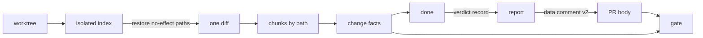

# Verdict scope

- **Status:** draft

A verdict that holds one fingerprint of the whole branch diff goes stale on any edit anywhere. Each
verdict records the fingerprint of the diff limited to its feature's `paths` and the registry's
shared globs, so an edit to another feature's files leaves it standing.

An attach target, one that wringer reaches but does not start, can report the commit it runs. A
verdict on it is then pinned to that commit's code. `report` writes a fixed-size data comment,
version 2, that `gate` reads in CI and checks against fingerprints it computes itself. `gate` checks
an agent's workflow, and a person who edits the PR body can forge a claim: see
[Open questions](#open-questions).

The fingerprints come from the isolated index: a copy of the repo's index, in a git folder of its
own, that reads no config of the clone or the user, so the same change gets the same fingerprint in
any clone.

## Shape



## Contracts

### Change facts

One call replaces `readFingerprint` and `readChangedPaths`. `done`, `report`, `gate` and run start
all read the branch through it.

```ts
const facts = await readChangeFacts(repoHost, {
  ...buildChangeRequest(wringer, root, base),
  scopes: collectFeatureScopes(wringer), // each feature's `paths` plus `wringer.shared`
  deployed: null, // or a full commit id, for the deployed check
});
// → {
//     mergeBase: '3f1c9e…',
//     fingerprint: '9ab07d…',                  // the whole diff
//     changedPaths: ['src/cart/add.ts'],       // sorted, after the ignore restore
//     featureFingerprints: Map { 'cart' → '48cd22…', 'checkout' → 'empty' },
//     deployedPaths: null }                    // or the paths that differ from `deployed`
```

```ts
// change-facts module
interface ChangeFactsRequest extends ChangeRequest {
  // …existing cwd, base, exclude, ignore
  readonly scopes: readonly FeatureScope[];

  // A full commit id. The facts then list each path whose content differs between that commit and
  // the isolated index, leaving out paths an ignore glob matches.
  readonly deployed: string | null;
}

interface FeatureScope {
  readonly name: string;
  readonly globs: readonly string[]; // the feature's `paths`, then every shared glob
}

interface ChangeFacts {
  readonly mergeBase: string;
  readonly fingerprint: Fingerprint;
  readonly changedPaths: readonly string[];
  readonly featureFingerprints: ReadonlyMap<string, Fingerprint>; // one entry per scope
  readonly deployedPaths: readonly string[] | null; // null when `deployed` is null
}

type Fingerprint = string; // a patch ID, or 'empty' for a diff with no file
```

A fingerprint takes these inputs, and nothing else:

- The merge base of `HEAD` and the base ref.
- The isolated index: the repo's own index, then `add --all` under git's default config, then the
  submodules, then each changed path an ignore glob matches restored to its merge-base state.
- The diff of that index against the merge base, with the existing pinned diff options, `--binary`,
  and the state folder excluded.
- For a feature, only the chunks whose path matches one of its scope's globs through `isGlobMatch`,
  sorted by the path's bytes and joined.
- `git patch-id --verbatim` over those bytes, or `empty` when no chunk matches.

### Registry

```ts
const wringer = createWringer({ name: 'shop' })
  .feature({ name: 'cart', summary: 'Add items to the cart', paths: ['src/cart/**'] })
  .shared('package.json', 'bun.lock', 'verify/**')
  .ignore('**/*.md')
  .gate({ unpinned: 'refuse' })
  .target('preview', {
    ...previewAccessAndHost,
    mode: 'attach',
    endpoints: () => ({ http: 'https://preview.example.test' }),
    revision: async (ctx) => (await ctx.drivers.http.getJSON('/health')).sha, // → '5e1d0a7'
  })
  .build();
```

```ts
// core types
interface WringerBuilder<Ds extends AnyDrivers> {
  // …existing methods
  readonly shared: (...globs: readonly string[]) => WringerBuilder<Ds>;
  readonly gate: (policy: GatePolicy) => WringerBuilder<Ds>;
}

interface Wringer {
  // …existing fields
  readonly shared: readonly string[]; // only what `.shared()` lists
  readonly gate: GatePolicy; // { unpinned: 'allow' } when the registry sets none
}

interface FeatureDefinition {
  // …existing name, summary and paths
  // Commands that check the feature without touching the app, such as `guide`, by their path.
  readonly commands?: readonly string[] | undefined;
}

interface GatePolicy {
  readonly unpinned: 'allow' | 'refuse';
}

interface AttachTarget<Ds extends AnyDrivers> extends TargetBase<Ds> {
  // …existing fields
  // The commit the deployment runs: 7 to 64 hex characters.
  readonly revision?: ((ctx: RevisionContext<Ds>) => string | Promise<string>) | undefined;
}

interface RevisionContext<Ds extends AnyDrivers> {
  readonly target: string;
  readonly endpoints: Endpoints;
  readonly drivers: DriverClients<Ds>;
  readonly signal: AbortSignal; // fires after 5 s
}
```

Each target also carries the `evidence: 'upload' | 'local'` policy that [PR report](./pr-report.md)
defines. The verdict records it.

### Run events

Two event types join `runEventSchema`. Neither changes an existing event, so a run log written
before them still parses.

```ts
// run-events module
z.strictObject({
  type: z.literal('scopes-read'), // written right after `run-started`, at the default base
  at,
  featureFingerprints: z.array(z.tuple([z.string(), fingerprintSchema])), // entries keep a feature named __proto__
}),
z.strictObject({
  type: z.literal('revision-read'), // written by `doctor` on an attach target with `revision`
  at,
  revision: z.string().regex(/^[0-9a-f]{7,64}$/u),
}),
```

### Verdict record

`done` returns this record as its data, and `readVerdicts` reads it back from the run logs. It stays
in the worktree.

```ts
// report-schema module
const nameSchema = z.string().min(1).max(64);
const fingerprintSchema = z.union([
  z.literal('empty'),
  z.string().regex(/^[0-9a-f]{40}([0-9a-f]{24})?$/u),
]);
const commitIDSchema = z.string().regex(/^[0-9a-f]{40}([0-9a-f]{24})?$/u); // full, as git resolves it

const pinSchema = z.discriminatedUnion('kind', [
  z.strictObject({ kind: z.literal('local') }), // a launch target: the run's own tree
  z.strictObject({ kind: z.literal('deployed'), revision: commitIDSchema }),
  z.strictObject({ kind: z.literal('unpinned') }), // an attach target with no `revision`
]);

const verdictTargetSchema = z.strictObject({
  name: nameSchema,
  evidence: z.enum(['upload', 'local']),
});

export const verdictSchema = z.strictObject({
  feature: nameSchema,
  fingerprint: fingerprintSchema, // the whole diff: names the state the run saw; never decides staleness
  featureFingerprint: fingerprintSchema, // at the gate's base; decides staleness
  run: z.string().max(32),
  at: z.iso.datetime(),
  target: verdictTargetSchema,
  pin: pinSchema,
  evidence: z.array(evidenceSchema.extend({ url: z.string().optional() })), // `url` is the link the repo's upload hook gave
});
```

### Report

`report` returns this shape as its data. [PR report](./pr-report.md) renders the tables from it.

```ts
// report-schema module
// `unpinned` appears only under the policy `{ unpinned: 'refuse' }`; otherwise such a verdict is `verified`.
const featureStatusSchema = z.enum(['verified', 'stale', 'missing', 'unchanged', 'unpinned']);

export const reportSchema = z.strictObject({
  base: z.string(),
  fingerprint: fingerprintSchema,
  complete: z.boolean(), // every feature verified or unchanged, and no unmapped path
  features: z.array(
    z.strictObject({
      name: nameSchema,
      changed: z.boolean(), // its fingerprint now is not 'empty'
      status: featureStatusSchema,
      verdict: verdictSchema.nullable(),
    }),
  ),
  unmapped: z.array(z.string()), // changed paths that no feature, shared glob or ignore glob matches
});
```

### Data comment

`report` builds the data comment from the report and the registry's name with `toReportComment`, and
`gate` reads it with `parseReportComment`. It holds one claim per verdict the report holds, and no
path list, so its size grows with the number of features only.

```ts
const comment = renderReportComment(toReportComment(report, wringer.name));
// → '<!-- wringer-data v2 {"version":2,"base":"origin/main",…} -->'

const read = parseReportComment(prBody);
// → { ok: true, comment: { version: 2, … } }
//   or { ok: false, reason: 'version-1', message: 'The PR body holds a version 1 report.' }
```

```ts
// report-schema module
// A claim is the verdict record with its evidence list swapped for a digest and a count.
const claimSchema = verdictSchema.omit({ evidence: true }).extend({
  evidenceDigest: z.string().regex(/^[0-9a-f]{64}$/u), // keys the upload record; see Constraints
  evidenceCount: z.number().int().nonnegative(),
});

export const reportCommentSchema = z.strictObject({
  version: z.literal(2),
  registry: nameSchema, // the `createWringer` name; `gate` fails a comment from another registry
  base: z.string().max(256),
  fingerprint: fingerprintSchema,
  claims: z.array(claimSchema).refine(hasUniqueFeatures, 'two claims name one feature'),
});

export type ReportComment = z.infer<typeof reportCommentSchema>;

type CommentRead =
  | { readonly ok: true; readonly comment: ReportComment }
  | {
      readonly ok: false;
      readonly reason: 'none' | 'version-1' | 'newer-version' | 'several' | 'unclosed' | 'invalid';
      readonly message: string;
    };
```

### Gate decisions

`gate` reads only the claims from the PR body. It computes each feature's fingerprint, `changed`,
its status and the unmapped paths itself, from the checkout and the registry CI runs.

The body decides first:

| The PR body holds                                         | `gate`                                                                       |
| --------------------------------------------------------- | ---------------------------------------------------------------------------- |
| one `<!-- wringer-data v2` comment that parses            | goes on to the feature rows                                                  |
| no data comment and no version 1 block                    | fails each changed feature as `missing`, with the reason that none was found |
| a `<!-- wringer-report v1` block and no data comment      | fails once, with the hint to run `report` and `publish` again                |
| a version 1 block and one version 2 comment               | reads the version 2 comment, and ignores the version 1 block                 |
| a `<!-- wringer-data v<n>` comment with `n` above 2       | fails once, with the hint to upgrade wringer                                 |
| two or more version 2 comments                            | fails once, with the hint to publish again                                   |
| a comment that is unclosed, not JSON, or fails the schema | fails once, with the parse reason and the hint to publish again              |

Then each feature in the registry gets one row:

| Feature fingerprint in CI | Its claim                                           | Status      | Result |
| ------------------------- | --------------------------------------------------- | ----------- | ------ |
| `empty`                   | any, or none                                        | `unchanged` | passes |
| not `empty`               | none                                                | `missing`   | fails  |
| not `empty`               | a `featureFingerprint` that differs                 | `stale`     | fails  |
| not `empty`               | equal, `pin.kind` is `unpinned`, policy is `refuse` | `unpinned`  | fails  |
| not `empty`               | equal, any other pin                                | `verified`  | passes |

`gate` also fails when the unmapped list is not empty. A claim for a feature the registry lacks
changes no row, and `gate` lists it in its data.

```ts
// gate's envelope data: …existing fingerprint, failing and unmapped
const gateDataSchema = existingGateDataSchema.extend({ unknownClaims: z.array(nameSchema) });
// each `failing` entry gains `status: featureStatusSchema`
```

## Constraints

- Changed paths, the whole fingerprint and every feature fingerprint come from one isolated index
  and one diff, so they always describe the same files.
- The ignore restore runs before the diff, so a path that only an ignore glob matches is in no
  fingerprint and no changed path.
- When the restore keeps an ignored name because a counted path sits inside it or around it, that
  name counts in the whole fingerprint and in each scope whose glob matches it, and it is never
  unmapped.
- A file that only the clone's `info/exclude`, the user's excludes or the user's attributes hide
  counts as changed, because the isolated index reads none of them.
- A fingerprint stays the same across a commit, and across a rebase that leaves the 3 lines of
  context around each change as they were. A rebase that changes those lines changes the
  fingerprint, because `patch-id --verbatim` hashes the diff's context.
- A fingerprint needs git 2.39 or later, the first release with `patch-id --verbatim`.
- A clone whose config converts a file as git adds it, such as `core.autocrlf` or a clean filter,
  can get another fingerprint once the change is committed. Its verdict then reads as stale, never
  as fresh.
- A sparse checkout, a linked worktree, a shallow or partial clone and a detached `HEAD` get the
  fingerprint that the same change gets in a full clone. A file on disk that the index marks
  skip-worktree counts as any other file.
- Reading the change facts fails with `environment` in a repo with no commit, in a shallow clone
  that lacks the merge base, and when a submodule holds work it has not committed.
- The split gives each name from `--name-only -z` its chunks in order, never by a name parsed from a
  `diff --git` header, so a space, a quote or a newline in a path is safe. A type change, such as a
  file that became a symlink, owns two chunks. A chunk count that does not match the names throws
  `internal`.
- A change to a path a shared glob matches changes every feature's fingerprint.
- `.shared()` adds only the globs the registry lists. Neither the registry's folder nor any other
  path joins the shared globs on its own.
- `lint` fails when the registry's own file matches no shared glob and no feature's `paths`. An
  ignore glob does not count as cover. The registry's own file is the `registry` option of
  `runVerify`, a path from the repo root, and defaults to the script that runs the CLI. `lint` skips
  the check when that file lies outside the repo.
- A path is unmapped when it matches no feature's `paths`, no shared glob and no ignore glob.
- `build` refuses a registry name, a feature name or a target name longer than 64 characters, and an
  empty registry name.
- `done` refuses a feature the registry does not list, as a usage error, because it has no
  fingerprint to record.
- `done` counts as a drive each envelope logged on the run after the doctor passed, with the feature
  current, that passed and either came from a command that needs a run and the doctor or from one
  the feature's `commands` lists. It refuses a feature with no such drive. A command another feature
  lists never counts, and a listed command that failed never counts. A listed command is logged
  under the run and feature it started with, and counts only when the doctor had passed on that run
  when it started, and that run and that feature are still current when its envelope is logged.
  Dispatch reads the pointers and appends the envelope under the pointers' lock, so `use` and `up`
  never move them between that check and the append.
- On a launch target, `done` compares the feature's fingerprint at the default base with the run's
  `scopes-read` value, and refuses with the hint `up --restart` when they differ or the run has no
  `scopes-read`.
- `done` records the feature's fingerprint at the base `--base` names, or at the default base. The
  launch check compares two default-base fingerprints, and `gate` compares the recorded one with its
  own at its `--base`, so neither compares across bases.
- A `revision` that throws a plain error fails as `environment`.
- On an attach target with `revision`, `doctor` runs it as one more check, named `revision`, on the
  same read-only drive, within 5 s. Each value is trimmed and lowercased first. The check fails when
  `revision` throws, times out, returns anything other than 7 to 64 hex characters, or returns a
  value that holds a known secret, as [Redaction](redaction.md) says. The doctor writes
  `revision-read` only when every check passes, just before `doctor-passed`.
- The registry builder refuses a repo check named `revision` when an attach target declares
  `revision`, with a `usage` error.
- `done` reads the `revision-read` that the latest `doctor-passed` follows, and calls `revision`
  once more on a read-only drive, within 5 s. A `doctor-passed` or `doctor-failed` with no
  `revision-read` before it clears the value. `done` refuses in each of these cases:
  - The run has no such `revision-read`. The hint is to run `doctor`.
  - The call throws or times out. The hint is to check the target, then run `done` again.
  - The two values differ as text, and they resolve to different full commit ids or either fails to
    resolve. The hint is to run `doctor` and drive the feature again.
  - The value is the same as the doctor's, or the two spellings name one commit, and
    `git rev-parse --verify --end-of-options <revision>` and the same with `^{commit}` appended do
    not both succeed with one id. That refuses a tag object, a tree, an ambiguous prefix and a
    commit the clone lacks alike. The hint is `git fetch origin <revision>`.
  - A path in the feature's scope differs between that commit and the isolated index. The message
    lists up to 10 such paths.
- `deployedPaths` compares every path either side holds, deletions included, and leaves out each
  path an ignore glob matches before any scope glob is applied.
- When none of those holds, `done` writes `pin: { kind: 'deployed', revision }` with the full commit
  id. Uncommitted edits outside the feature's scope never block the pin. `--base` changes only
  `featureFingerprint`, never the deployed check.
- On an attach target with no `revision`, `done` writes `pin: { kind: 'unpinned' }`. The launch
  check never runs on an attach target.
- Until [PR report](./pr-report.md) adds `evidence` to targets, `done` records `evidence: 'local'`.
- `gate` computes `unpinned` from its own registry's policy, whatever status the report showed.
- One claim takes at most 1,000 characters once escaped, whatever its evidence count, and
  `toReportComment` throws `internal` on a longer one. `report` refuses a `--base` over 256
  characters as a usage error.
- `readVerdicts` drops a record that fails the version 2 schema, so a feature whose only verdict
  predates version 2 reads as `missing` until `done` runs again.
- Version 2 has no optional field and no default. A comment that lacks a field or adds one fails the
  schema.
- `evidenceDigest` is the SHA-256 hex of the UTF-8 bytes of
  `JSON.stringify(evidence.map((item) => [item.kind, item.path, item.sha256]))`, in the order `done`
  recorded. `gate` never reads `evidenceDigest`, `evidenceCount`, `run` or `at`.
- `renderReportComment` escapes the JSON as JSON Unicode escapes, so that `JSON.parse` alone reads
  it back: every `<` as U+003C, every `>` as U+003E, every backtick as U+0060, and each `-` that
  another `-` follows as U+002D, each written as a backslash, `u` and the four hex digits. A comment
  never holds `--`, `<`, `>` or a backtick before its closing `-->`.
- The data comment's opener is `<!-- wringer-data v2 `, and its close is ` -->`. The markers around
  the whole report belong to [PR report](./pr-report.md).

## Decisions

- **Staleness is per feature.** A verdict goes stale only when its feature's files or a shared path
  change, so an edit elsewhere costs no new run.
- **The deployed pin compares code, never commits.** A verdict stands when the deployed commit holds
  the same content as the worktree in the feature's scope, so `HEAD` need not be the deployed commit
  and the tree need not be clean.
- **Shared globs are explicit.** A silent addition, such as the registry's folder, hides from the
  reader why every feature went stale; `lint` catches the registry file instead. A shared glob costs
  a new verdict for every feature on each change it matches, such as a lock-file bump, so a registry
  lists only paths that change every feature's behaviour.
- **The data comment is fixed size per feature.** Evidence links live in the rendered tables and the
  upload record, so a verdict with many files never makes the PR body too long.
- **`gate` refuses version 1 outright.** A version 1 block holds no feature fingerprint, so `gate`
  cannot judge it.
- **A feature that never touches the app names the commands that check it.** A verdict on `guide`
  rests on `guide` commands, so the journey and the report show what was checked; an extra app
  command would make the verdict claim a check the journey never made.
- **An unmapped path fails the gate.** Every changed path either belongs to a feature, is shared, or
  is ignored as having no effect.

## Builder decides

- The names of internal functions and files, such as the chunk splitter and the scope matcher.
- Whether the split reads `--raw -z` statuses or counts headers to give a type change its two
  chunks.
- How many `patch-id` calls run at once, and the wording of each refusal and hint.

## Out of scope

- `publish`, the report markers, the rendered tables, the uploader and the upload record:
  [PR report](./pr-report.md).

## Open questions

- **Can `gate` trust a claim?** Anyone who can edit the PR body can write a claim, and a fingerprint
  is computable from the branch alone, so a forged verdict passes. The owner settles whether claims
  need attestation. Until then, `gate` trusts every claim that parses, and it checks the honesty of
  an agent's workflow, never the intent of someone with write access.

## Work items

### Read change facts from one diff

**Outcome:** `readChangeFacts` gives the changed paths, the whole fingerprint and each feature's
fingerprint from one isolated index, and the registry takes `.shared()`.

**Sketch:** [Change facts](#change-facts), and `shared` in [Registry](#registry).

**Acceptance:**

- [ ] An edit to one feature's file changes only that feature's fingerprint. Evidence:
      `readChangeFacts` tests in a real git repo.
- [ ] An edit to a shared path changes every feature's fingerprint. Evidence: `readChangeFacts`
      tests.
- [ ] An edit to a path only an ignore glob matches changes no fingerprint and no changed path.
      Evidence: `readChangeFacts` tests.
- [ ] A file that became a symlink, and a path with a space, a quote and a newline, each split to
      their own chunks. Evidence: chunk splitter tests.
- [ ] A file hidden only by `info/exclude` is a changed path. Evidence: `readChangeFacts` tests.

### Scope verdicts to their feature

**Depends on:** Read change facts from one diff.

**Outcome:** `done` records a version 2 verdict record, and `report` marks a feature stale only when
its own fingerprint changes.

**Sketch:** [Verdict record](#verdict-record), [Report](#report), and `scopes-read` in
[Run events](#run-events). Every attach target writes `unpinned` until the deployed pin lands.

**Acceptance:**

- [ ] In the shop example, a verdict on `cart` stays `verified` after an edit to a checkout file.
      Evidence: `report` tests over the shop registry.
- [ ] `done` on a launch target refuses after an edit inside the feature's scope since `up`, and
      accepts after an edit outside it. Evidence: `done` tests.
- [ ] A verdict recorded before version 2 reads as `missing`. Evidence: `readVerdicts` tests.
- [ ] `build` refuses a feature name of 65 characters. Evidence: `createWringer` tests.

### Write and gate the version 2 data comment

**Depends on:** Scope verdicts to their feature.

**Outcome:** `report` writes the data comment, and `gate` follows [Gate decisions](#gate-decisions),
with the registry's `.gate()` policy.

**Sketch:** [Data comment](#data-comment), [Gate decisions](#gate-decisions), and `gate` in
[Registry](#registry).

**Acceptance:**

- [ ] Each row of both gate tables gives its result. Evidence: one `gate` test per row.
- [ ] A comment round-trips claims whose names hold `<`, `>`, `--` and a backtick, and its text
      holds none of them. Evidence: `renderReportComment` and `parseReportComment` tests.
- [ ] A comment for 30 features with 200 evidence files each stays under 32,000 characters.
      Evidence: `renderReportComment` test.
- [ ] `gate` fails on an unmapped path when every feature is verified. Evidence: `gate` tests.

### Pin verdicts to the deployed commit

**Depends on:** Scope verdicts to their feature.

**Outcome:** An attach target with `revision` gets `deployed` verdicts when its deployed code
matches the worktree in the feature's scope.

**Sketch:** `revision` in [Registry](#registry), `revision-read` in [Run events](#run-events), and
the attach rules in [Constraints](#constraints).

**Acceptance:**

- [ ] `done` pins a verdict when the deployed commit differs from `HEAD` only outside the feature's
      scope, with uncommitted edits outside it. Evidence: `done` tests in a real git repo.
- [ ] `done` refuses, naming the paths, when the deployed commit differs inside the scope. Evidence:
      `done` tests.
- [ ] `done` refuses an unknown commit with a fetch hint, and a revision that changed since
      `doctor`. Evidence: `done` tests.
- [ ] `doctor` fails when `revision` returns `main` or takes longer than 5 s. Evidence: `doctor`
      tests.

### Lint the registry file's cover

**Depends on:** Read change facts from one diff.

**Outcome:** `lint` fails when the registry's own file matches no shared glob and no feature's
`paths`.

**Acceptance:**

- [ ] `lint` fails on a registry whose file only an ignore glob matches, and passes once `.shared()`
      lists it. Evidence: `lint` command tests.
